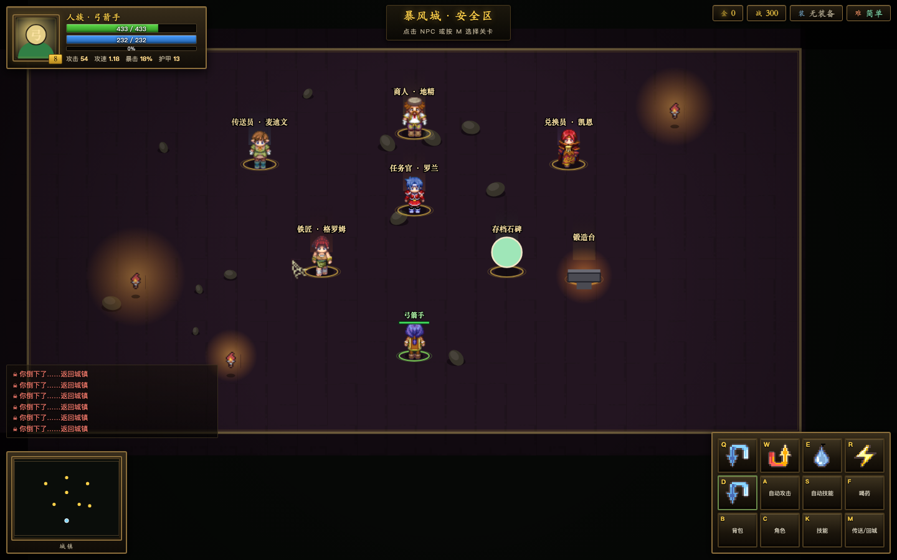

# 兽人永不为奴 / 仙剑奇缘

一个 **单文件网页 ARPG**（打怪 / 爆装 / 升级 / 套装），魔兽争霸3 风格，2.5D 俯视角。
**双击 `dist/兽人永不为奴.html` 就能玩，无需安装、无需联网。**



---

## 快速开始

```bash
git clone git@github.com:Jiawk/Bird_RPG.git
cd Bird_RPG
open dist/兽人永不为奴.html      # macOS
# 或者直接把 dist/兽人永不为奴.html 拖进浏览器
```

想改代码：

```bash
# 直接打开开发版（需本地起个静态服务器，或直接开 index.html）
python3 build.py     # 重新打包成单文件 dist/兽人永不为奴.html
```

---

## 设计文档

后续所有更新都以这两份文档为基准：

| 文档 | 内容 |
|---|---|
| [世界观设定-艾泽拉斯](世界观设定-艾泽拉斯.md) | 泰坦 / 古神 / 燃烧军团 / 艾泽拉斯通史 / 主要人物 / 地图命名规范 |
| [游戏系统参考-魔兽III与WOW](游戏系统参考-魔兽III与WOW.md) | 种族 / 职业 / 技能 / 装备 / 成长 / 副本设计，含**对标差距**与**更新路线图** |

## 玩法

| 操作 | 按键 |
|---|---|
| 移动 | **右键单击地面** / 方向键 / 触屏摇杆 |
| 普通攻击 | 按住 **鼠标左键** |
| 技能 | **Q W E R** |
| 位移 / 闪现 | **D** |
| 自动攻击（含自动寻怪） | **A** |
| 自动技能 | **S** |
| 喝药 | **F** |
| **回城** | **H** |
| 与 NPC 交互 | **右键点 NPC** / 走近按 **E** |
| 背包 | **B** |
| 角色面板 | **C** |
| 技能页 | **K** |
| 传送 / 选关 | **M** |
| 存档 | **F5** |

---

## 核心系统

### 职业与主属性

每个职业有唯一主属性，主属性直接决定输出，敏捷额外影响攻速/暴击/闪避，体质决定血量。

| 职业 | 主属性 | 伤害类型 | 定位 |
|---|---|---|---|
| 战士 | **力量** | 物理 | 高血量、高护甲、近战爆发 |
| 法师 | **智力** | 法术 | 高法强、AOE、身板脆 |
| 弓箭手 | **敏捷** | 物理 | 远程持续输出 |
| 刺客 | **敏捷** | 物理 | 高暴击、高攻速、生存靠闪避 |

```
生命 = 职业基础 + (等级-1)×成长 + 体质×6 + 等级×10
攻击 = 职业基础 + (等级-1)×成长 + 主属性×2 + 装备攻击
法强 = 职业基础 + (等级-1)×成长 + 智力×2.5 + 装备法强
攻速 = 职业基础攻速 × (1 + 敏捷/500)
暴击 = 5% + 敏捷/2000 + 装备暴击      (上限 60%)
闪避 = 敏捷/3000 + 装备闪避           (上限 30%)
减伤 = 护甲 / (护甲 + 1000 + 等级×50)
```

### 技能

每个职业 **5 个主动（QWER + D 位移）+ 2 个被动**，共 28 个技能。

| 职业 | Q | W | E | R | D |
|---|---|---|---|---|---|
| 战士 | 旋风斩 | 盾墙 | 战斗怒吼 | 斩杀 | 冲锋 |
| 法师 | 火球术 | 冰霜新星 | 暴风雪 | 奥术洪流 | 闪现 |
| 弓箭手 | 多重射击 | 穿透箭 | 冰冻陷阱 | 急速射击 | 后跳 |
| 刺客 | 背刺 | 毒刃 | 刀扇 | 消失 | 影袭 |

### 装备

- **8 部位**：武器 / 头盔 / 胸甲 / 护腿 / 战靴 / 项链 / 戒指 / 饰品
- **6 品质**：普通(白) → 优秀(绿) → 精良(蓝) → 史诗(紫) → 传说(橙) → 神话(红)
- 属性倍率 `1.00 / 1.35 / 1.80 / 2.40 / 3.20 / 4.40`
- 16 种随机词条，品质越高词条越多（0~5 条）
- 掉落偏向玩家伤害类型

### 职业套装

每个职业有专属套装，**集齐 4 件 / 6 件**触发阶级加成：

| 职业 | 套装 | 4 件 | 6 件 |
|---|---|---|---|
| 战士 | 破军 | 力量 +20% | 力量 +40 · 技能伤害 +20% |
| 法师 | 霜语 | 智力 +20% | 智力 +40 · 技能伤害 +20% |
| 弓箭手 | 风行 | 敏捷 +20% | 敏捷 +40 · 技能伤害 +20% |
| 刺客 | 影杀 | 敏捷 +20% | 敏捷 +40 · 技能伤害 +20% |

套装件 15% 概率从对应部位掉落，角色面板可看集齐进度。

### 战力值

```
战力 = 装备分 + 技能分 + 等级分 + 属性书分
装备分 = Σ[ (品质档+1)×30 + 物品等级×6 + 词条加权 ]
技能分 = Σ 各技能等级 × 26
```

背包里更强的装备会显示 **绿色 ▲** 和具体战力增量；悬停显示逐条属性差值对比。

### 背包与出售

- **6 页 × 24 格 = 144 格**
- 药水自动堆叠，显示 `×N`
- **一键出售低战力**：卖掉所有换上后战力不升的装备
- **自动出售低战力**：捡到当场折现，不进背包
- 空格位的装备永远不会被卖

### 任务与锻造

主城找 **任务官·罗兰** 接悬赏（指定房间杀 N 只），奖励经验 / 金币 / 材料。
**锻造台** 用材料合成高级装备：

| 配方 | 产出 |
|---|---|
| 魔铁锭×8 + 秘银矿×4 + 1200 金 | 史诗（紫） |
| 秘银矿×8 + 龙鳞片×4 + 3600 金 | 传说（橙） |
| 龙鳞片×6 + 虚空碎片×6 + 9000 金 | 神话（红） |

### 难度与关卡

进图前选难度，难度影响怪物血量/攻击/掉落：

| 难度 | 生命 | 攻击 | 建议装备 |
|---|---:|---:|---|
| 简单 | ×1.00 | ×1.00 | 绿装 |
| 困难 | ×2.20 | ×1.45 | 蓝装 |
| 地狱 | ×4.60 | ×2.60 | 紫装 |

| 房间 | BOSS | 血量 |
|---|---|---:|
| 贫瘠之地 | 半人马可汗 | 1,500 |
| 废弃矿洞 | 狗头人地卜师 | 4,200 |
| 兽人营地 | 格罗姆·地狱咆哮 | 11,500 |
| 亡灵墓穴 | 克尔苏加德 | 25,000 |
| 燃烧军团裂隙 | 玛诺洛斯 | 52,000 |
| 深渊祭坛 | 阿克蒙德 | 95,000 |

> 集齐蓝装可过「下一关简单 + 本关困难」；集齐紫装可过「下一关困难 + 本关地狱」。

### 存档

- 每 **5 秒**自动存档 + 回城时存档
- localStorage 保存，支持导出/导入 JSON

---

## 技术

- **纯原生 JS + Canvas 2D**，零框架、零依赖
- 单文件产物 **461 KB**，所有素材 base64 内嵌
- 2.5D：Y 轴压缩 0.70 + 单位立 height + 按世界 Y 排序做纵深遮挡
- 行走图：RMXP 标准 4 方向 × 4 帧，32×48 单帧

```
.
├── dist/兽人永不为奴.html   # 单文件产物
├── assets/                    # units/monsters/tiles/icons 图集
├── js/
│   ├── assets.js   # 素材 base64
│   ├── data.js     # 数据表（职业/技能/装备/套装/怪物/房间/难度/任务）
│   ├── core.js     # 属性计算 / 装备生成 / 战力 / 套装 / 存档
│   ├── world.js    # 房间 / 怪物 / 掉落 / NPC
│   ├── combat.js   # 伤害 / 技能 / 掉落判定
│   ├── render.js   # 2.5D 渲染
│   ├── ui.js       # HUD / 面板 / 弹窗
│   └── main.js     # 主循环 / 输入 / 自动战斗
├── css/style.css
├── index.html
└── build.py        # python3 build.py 打包
```

---

## 调试入口

在 URL 后加 hash：

| Hash | 效果 |
|---|---|
| `#dev` | 8 级弓箭手（城镇） |
| `#dev0`~`#dev5` | 直接进对应房间 |
| `#devc` | 打开角色面板 |
| `#devb` | 打开背包（带测试装备） |
| `#dev1d` | 关闭自动拾取 + 击杀 5 只怪 |

---

## 已知限制

- 无音效 / BGM
- 无精英怪
- 怪物 AI 只有简单追击
- 数值按公式推演，需要实玩反馈微调

欢迎提 issue 或 PR。

---

## 更新日志

### v7
- **装备图标**：从 `i43 像素画大全集 / 道具、技能 / 道具 (7).png` 切出 8 个 16×16 图标（剑 / 盔 / 甲 / 腿 / 靴 / 项链 / 戒指 / 护符），2 倍放大内嵌
- **角色面板**：装备栏放大到 276px（图标 44px），属性栏收窄到 0.68fr
- **技能特效**：新增 VFX 系统 —— 施法时地面冲击环 + 放射光线 + 中心闪光，颜色跟随技能
- 职业套装 / 战力 / 6 页背包 / 任务锻造 / 5 秒自动存档

### 设计取舍
- 装备图标为 16×16 像素画放大 2 倍（`image-rendering: pixelated`），保持像素风统一
- 技能特效是**程序化绘制**（Canvas 圆弧 + 径向渐变），不依赖序列帧，因此任何技能都能立刻有特效

### v8
- **产物改名**：`dist/兽人永不为奴.html` → **`dist/兽人永不为奴.html`**
- **技能图标**：从 `i43 素材 / 道具、技能 / 道具 (6).png` 与 `道具 (7).png` 切出 24 个 16×16 技能图标，命令卡改为**图标式按钮**（名字走 tooltip）
- **技能悬浮提示**：显示技能等级、冷却、法力消耗、**预计伤害**、伤害系数、作用范围与描述
- **素材整理**：`游戏素材/` 下所有 zip 已解压并删除（省 355MB）

### v9
- **等级锁**：背包里等级不够的装备显示**红色斜纹蒙层 + 灰化图标 + 「需 Lv.N」标签**，点击会提示「等级不足」，tooltip 顶部红字提示
- **命中特效**：从 `i43 素材 / 角色动作 / Breath of Fire (1).gif` 切出 3 个特效帧（金色爆炸星 / 四角星刃 / 碎火花），去白底后做成 `assets/fx.png`
  - 技能施放 → 金色爆炸星（随技能旋转放大）
  - 技能命中 → 火花（50% 概率）
  - 普通攻击命中 → 小火花（35% 概率）

### v10
- **怪物密度**：每个房间 **50 小怪 + 20 精英 + 2 BOSS**（第二只 BOSS 为「幼·」小 BOSS，60% 血量）
- **精英怪**：金色光环、体型 1.6 倍、血量 ×2.6、攻击 ×1.6、经验 ×3、金币 ×3
- **爬塔副本**：20 层，每天 2 次，`T` 键进入。怪物生命 ×(1+0.62×层)、攻击 ×(1+0.30×层)
  - 每层奖励：金币、强化石；每 3 层技能强化券，每 5 层强化保护券，每 10 层技能突破券
- **装备强化**：最高 +15，铁匠处强化
  - +1~+5 必成，+6~+10 成功率 72%，+11 起 45% 且失败掉一级
  - 每 +1 提升装备属性 6%（+15 = +90%），战力同步计入
- **技能强化**：5 层，每层 0~100% 熟练度
  - 杀怪 +1.5%（精英 ×3，BOSS ×8），技能强化券 +15%
  - 满 100% 用技能突破券突破，每层 +8% 伤害、-5% 冷却
- **BOSS 首杀成就**：首次击杀 BOSS 掉落专属戒指，装备在新增的「印记」槽
  | BOSS | 戒指 | 效果 |
  |---|---|---|
  | 半人马可汗 | 可汗之戒 | 经验 +15% |
  | 狗头人地卜师 | 矿脉之戒 | 金币 +30% |
  | 格罗姆 | 战歌之戒 | 吸血 +5% |
  | 克尔苏加德 | 亡灵之戒 | 5% 概率斩掉 5% 最大生命 |
  | 玛诺洛斯 | 燃烧之戒 | 暴击伤害 +35% |
  | 阿克蒙德 | 深渊之戒 | 掉落品质 +35% |

### v11（体验修复）
- **锻造台改为两步式**：第一步展示**身上 8 格装备**（含强化等级 `+N`）+ 备份背包装备，点击选中；第二步进入强化详情页，显示 `+7 → +8`、成功率、属性提升预览、金币/强化石消耗（不足会标红）
- **技能强化可读性**：
  - 熟练度条从 9px 加粗到 16px 并带 `100/100` 白色描边文字
  - 面板顶部常驻材料栏（技能强化券 / 技能突破券数量 + 杀怪收益说明）
  - 突破按钮直接显示 `突破 → 2 层 / 突破券 0/1`，缺券时按钮变红
  - 点击后 toast 明确提示：`❌ 缺少技能突破券（现有 0 张）`
- **修复 toast 被弹窗遮住**：z-index 从 60 提到 **300**（原来弹窗 70，提示根本看不见，这就是「点突破没反应」的真正原因）
- **禁用浏览器右键菜单**：`document` 级 `contextmenu.preventDefault()`，Mac 触控板双指点按不再弹出系统菜单

### v12
- **任务改为可并行接取**：不再限制 1 个，可同时持有多个悬赏
  - 进行中列表带**进度条**（`7/12`）、奖励预览、完成时绿色高亮
  - **「一键全部接取」**按钮，一次接完所有已解锁任务
  - 完成后单独点「领取」，也可「放弃」中途任务
  - 同房间的多个任务，击杀会**同时计数**
- 旧存档自动迁移（单个 `quest` → `quests[]`）

### v13
- **小怪会游荡**：未进入战斗的怪物会在**出生点周围 26~72px** 范围内随机来回走
  - 每 1.6~4.2 秒换一个目标点，移动速度是追击时的 34%
  - 走动时播放行走动画并按方向转身
  - 进入仇恨后立即转为追击，游荡停止
  - BOSS 不游荡（保持站桩，方便预判）

### v14
- **进图自动开打**：进入任何战斗房间（含爬塔层）时自动开启 **A 自动攻击** 和 **S 自动技能**，不用再手动点
  - 主城不触发
  - 首次自动开启时右上角会提示「已自动开启 自动攻击(A) + 自动技能(S)」
  - 手动关掉后，下次进图会重新自动开启

### v15
- **套装重做：每图一套，共 24 套**（4 职业 × 6 图）
  - 例：弓箭手 → 荒野风行 / 矿脉风行 / 战歌风行 / 亡灵风行 / 燃烧风行 / 深渊风行
  - **只有「地狱」难度才能掉落，概率 7%**（最低）
  - 越高图的套装越强：第 1 图 4件 +10% 主属性，第 6 图 4件 +35%
- **套装查看位置**：按 `C` → 右侧「职业套装（6 套 · 仅地狱掉落）」列表
  - 每套显示 `已集齐 N/6`，有件数的显示金色
  - **点击任意一套 → 打开套装图鉴**：掉落来源、6 个部件是否已穿戴/在背包/未获得、4件/6件效果与激活状态
- 同一时间只有「集齐件数最多」的那一套生效

### v16
- **进图等级警告**：等级低于推荐时会弹窗，给出「极度危险 / 危险 / 稍有挑战」判定，并用你当前 DPS 估算 `BOSS 生命 / 击杀耗时 / 可承受伤害`，明显打不过会红字提示
- **`J` 键**直接打开任务面板
- **特戒系统补全**：
  - 特戒效果真正接入属性（经验/金币/吸血/暴击伤害/切割/掉落），此前只是存了字段没生效
  - **按效果区分颜色**：经验紫、金币金、吸血红、切割青、暴伤橙、掉落绿
  - **特戒可强化**，强化按比例放大特戒效果（+15 = ×1.9）；锻造页显示 `14.3% → 15.2%` 的效果预览
  - 新增**第二特戒槽「副印记」**（`ring2` + `ring3`）
- **C 面板重排**：装备分列人物左右（左：武器/头盔/胸甲/护腿；右：战靴/项链/戒指/饰品），**特戒槽放在中间立绘下方**，属性列在最右
- 新增全局 JS 错误提示（出错会弹 toast，不再静默黑屏）

### v17
- **存档石碑换素材**：从 `游戏素材/extracted/dungeon2/Tiles-Props-pack.png` 切出「符文石板 + 石基座」组合，重新缩放拼成完整石碑，替换原来的绿色圆圈
- **右侧任务追踪面板**（主界面中部右侧悬浮）
  - 点击标题栏可**折叠 / 展开**
  - 每条任务显示 `名称 + 进度 + 进度条`，完成的变绿并出现「领取」按钮
  - 底部两个按钮：**一键交任务（N）** / **一键接任务（N）**，无可操作时自动置灰
  - 没有任务时自动隐藏

### v18
- **武器种类系统**：武器不再是通用「利剑」，而是分 7 种，与本命职业匹配时有加成
  | 武器种类 | 本命职业 | 加成 | 普攻特效 |
  |---|---|---|---|
  | 剑 / 斧 | 战士 | 攻击 +12% | 挥砍 |
  | **弓 / 弩** | **弓箭手** | **攻击 +12% / +10%** | **箭矢** |
  | 匕首 | 刺客 | 攻击 +12% | 突刺 |
  | 法杖 / 法球 | 法师 | 攻击 +12% / +10% | 法术弹 |
- **掉落偏向本命**：88% 概率掉落本职业可用的武器（弓箭手基本只会掉弓/弩）
- **弓箭手普攻改为箭矢**：细长箭杆 + 白色箭头 + 尾羽拖尾，朝飞行方向旋转
- 法师装备法杖时普攻为紫色法术弹
- 背包 tooltip 显示 `弓类 · 本命武器 攻击 +12%`，角色面板核心属性新增「本命武器」行

### v19
- **新增「复活之戒」**：死亡时原地复活（50% 生命 + 3 秒无敌），**120 秒冷却**
  - 获取方式：首次通关爬塔第 20 层
  - 实现为 `DATA.SPECIAL_RINGS.revive`，走通用戒指工厂 `makeRing()`，后续加新特戒只需加一条数据
- **特戒槽扩充到 4 个**（印记 / 副印记 / 印记III / 印记IV），2×2 网格排在角色立绘下方
  - 装备时自动填入第一个空槽，满了进背包
  - 全部 6 枚 BOSS 首杀戒指 + 复活之戒共 7 枚，可同时佩戴 4 枚

---

## 完整更新日志（按提问顺序）

> 从最初搭框架到现在，每一次提的问题和对应的改动都在这里。

### v1 · 初始搭建
| 需求 | 实现 |
|---|---|
| 做一款魔兽风格打怪爆装游戏 | 原生 JS + Canvas 2D，4 职业 6 房间，localStorage 存档 |

### v2 · 第一批 7 条
| 需求 | 实现 |
|---|---|
| 自动攻击 + 技能自动释放，QWER + D 闪现 | 命令卡 A/S 开关；每职业 5 主动 + 2 被动，共 28 技能 |
| 改为 2.5D | Canvas 实现 Y 轴压缩 0.70 + 单位立起 + 按纵深排序 |
| 数值太高打不过 BOSS | 全表重标定，BOSS 血量下调 |
| 难度改为每次进图选 | 进图前弹窗选简单/困难/地狱 |
| 装备阶段门槛 | 蓝装过「本关困难+下关简单」，紫装过「本关地狱+下关困难」 |
| 要真正的魔兽3 UI | 底部三段式面板（头像/命令卡/小地图），绿血蓝法 |
| B 键关不掉背包 | 所有面板改为同键切换，Esc 关闭 |
| 权限 | 授权后不再询问 |

### v3
| 需求 | 实现 |
|---|---|
| 头像左上、地图左下、技能右下 | 三处独立面板重排 |
| 右键单击就移动到指定点 | `G.moveTarget` 持续走向目标，到达自动停 |
| 右键 NPC 直接交互 | 落点在 NPC 46px 内即打开面板 |
| 人物是圆圈、地图没有 | 接入地砖平铺 + 像素精灵 |

### v4
| 需求 | 实现 |
|---|---|
| 全屏自动拾取 | `G.autoPickup`，落地 0.7 秒后自动收 |
| 用行走图素材重做人物 | 从 2937 张素材挑 14 个 RMXP 角色，4 方向 × 4 帧 |
| 掉落物要有 UI | 图标 + 名牌 + 光柱 + 地面光晕 |

### v5
| 需求 | 实现 |
|---|---|
| 自动走到怪物前攻击 + 刷怪间隔减半 | 超距离自动接近；重生 30s → 15s |
| 回城键是哪个 | 新增 `H` 回城（原来 H 被占用做存档） |
| 悬停装备显示对比 | 逐条 ▲/▼ 绿红差值 + 战力增减结论 |
| 引入战力值 + 绿色箭头 | 全套评分公式；背包更强装备标 ▲ 和 +N |
| 主城杀怪任务 + 材料合成 | 任务官罗兰 + 锻造台（紫/橙/红三档） |
| 移动和攻击没有动作 | 走路帧 9fps + 颠簸；攻击切帧 + 前冲 + 挥砍弧 |

### v6
| 需求 | 实现 |
|---|---|
| 红蓝药堆叠 | `×N` 堆叠，喝一瓶减 1 |
| 背包再开 5 页 | 6 页 × 24 = 144 格 |
| 角色面板按参考图 | 三栏：装备栏 \| 立绘+战力 \| 核心/基础/额外属性 |
| 一键出售 + 自动出售 | 判定「换上后战力不升」，空槽位不卖 |

### v7
| 需求 | 实现 |
|---|---|
| 出售判定不变 | 保持宽松判定 |
| 装备图标切出来 | 从 i43 图标格切 8 个部位图标 |
| 初始化并上传 GitHub | 建仓库、写 README、首次推送 |
| 职业专属套装 | 4 套，4件/6件触发加成 |
| 主属性挂钩伤害防御血量法强 | 明确公式并展示在面板 |
| 每 5 秒自动存档 | 30s → 5s |

### v8
| 需求 | 实现 |
|---|---|
| 解压所有 ZIP 并删除 | 19 个 zip（含嵌套）全解压，删包省 355MB |
| 技能没有图标 | 切 24 个技能图标，命令卡改图标式按钮 |
| 产物改名为游戏名 | `兽人永不为奴.html` |
| 技能悬浮显示说明和伤害 | 等级/冷却/法力/预计伤害/系数/范围/描述 |

### v9
| 需求 | 实现 |
|---|---|
| 继续做角色动作 GIF | 分析后判定不适合做角色动画，改为提取特效帧 |
| 未达等级装备要明显 | 红色斜纹蒙层 + 图标灰化 + 「需 Lv.N」 |

### v10
| 需求 | 实现 |
|---|---|
| 小怪 50 + 精英 20 + BOSS 2 | 精英金环、1.6 倍体型 |
| 爬塔副本 20 层 | 每天 2 次，`T` 进入，逐层奖励 |
| 装备强化规则 +15 | 分区成功率，+11 起失败掉级 |
| 技能 5 层熟练度 | 杀怪/券加熟练度，突破券升层 |
| BOSS 首杀成就戒指 | 6 枚，按效果分颜色 |

### v11
| 需求 | 实现 |
|---|---|
| 锻造台 UI 要能看出强化哪件 | 两步式：先选身上装备 → 再进强化详情 |
| 技能强化看不懂、点突破没提示 | 熟练度条加大；**toast 被弹窗遮挡**是根因，z-index 60→300 |
| Mac 右键弹出系统菜单 | document 级拦截 contextmenu |

### v12–v19
| 需求 | 实现 |
|---|---|
| 任务只能接一个 | 改数组，支持并行/一键接取/放弃 |
| 小怪应该来回走动 | 出生点 26~72px 游荡，34% 速度 |
| 进图自动开 A 和 S | 进战斗图自动开启，主城不触发 |
| 套装在哪看 / 每图一套 / 仅地狱掉 | 24 套，C 面板列表 + 套装图鉴，7% 地狱掉率 |
| 等级警告 + J 键 + 特戒 UI + C 面板重排 | 全部实现，特戒效果真正接入属性计算 |
| 存档石碑换素材 + 右侧任务追踪 | 符文石板 sprite；可折叠追踪面板 |
| 弓箭手没有弓 | 7 种武器按本命分配，88% 掉本命；箭矢特效 |
| 复活戒指 + 特戒槽位 + README | 本版本 |

### v20
- **锻造台加强化入口**：顶部新增「⚒ 装备强化 → 打开」，与铁匠功能一致
- **锻造台用途写清楚**（原来只显示一排材料，看不出要做什么）：
  - 标题「材料合成装备」
  - 说明：用材料**直接打造**指定品质装备（部位随机），材料来自悬赏任务与怪物/BOSS 掉落
  - 材料栏**只显示 4 种合成材料**（原来把强化石、技能券也混进来了）
  - 每条配方显示 **各材料 已有/需要**，不足标红，并注明产出品质与可选部位

### v21
- **难度选择显示战力对比**，帮你判断该不该进
  - 每个难度卡显示：`推荐战力` / `你的战力` / 进度条 / 结论
  - 结论分四档：**战力充足**（绿）≥100%、**勉强能打**（黄）≥80%、**战力偏低**（橙）≥55%、**战力严重不足**（红）<55%
- **推荐战力按房间标定**（用各档装备实测战力反推）：

  | 房间 | 简单 | 困难 | 地狱 |
  |---|---:|---:|---:|
  | 贫瘠之地 | 2,600 | 4,030 | 6,110 |
  | 废弃矿洞 | 4,200 | 6,510 | 9,870 |
  | 兽人营地 | 7,200 | 11,160 | 16,920 |
  | 亡灵墓穴 | 9,200 | 14,260 | 21,620 |
  | 燃烧军团裂隙 | 12,200 | 18,910 | 28,670 |
  | 深渊祭坛 | 16,800 | 26,040 | 39,480 |

  难度倍率：简单 ×1.00 / 困难 ×1.55 / 地狱 ×2.35
- 房间列表的每个按钮也显示 `推荐 XXXX　你 XXXX`，按达标情况染色
- 等级警告弹窗里也加了战力对比行

### v22 · 双版本 + 新手装备
- **新手初始装备**：建角后直接获得一套「优秀」品质装备（8 部位），开局战力约 3,000，不用先刷绿装
- **保留经典版入口**：`dist/index.html` 是版本选择页，两个版本并存
  | 版本 | 文件 | 风格 |
  |---|---|---|
  | 经典版 | `兽人永不为奴.html` | 像素地牢风 · RMXP 4 方向行走 |
  | **水墨版** | `艾泽拉斯的回响·水墨版.html` | Q 版国风武侠 · 水墨山景背景 |
- **水墨版替换的素材**（来自 `游戏素材/Q版水墨国风武侠割草手游美术参考`）：
  | 用途 | 来源目录 | 说明 |
  |---|---|---|
  | 场景地图 | `场景背景/` | 水墨山水图直接铺满战场，替代地砖平铺 |
  | 角色 / 怪物 | `角色立绘/` | 14 个 Q 版武侠立绘，作为 billboard 单位 |
  | 技能图标 | `技能图标/` | 24 个（冰/火/雷/光/毒五系） |
  | 装备图标 | `装备道具/` | 剑/扇/宝石/裤子/戒指五类中挑 8 个 |
  | 技能特效 | `UI特效图集/` | 3 帧 |
- 打包方式：`python3 build.py` 出经典版，`python3 build.py --theme=wq` 出水墨版

### v23 · 特戒槽位 / 爬塔入口 / 双图鉴（两个版本通用）
- **主城新增「试炼之塔 · 入口」NPC**（紫色法阵），右键或走近按 E 即可打开爬塔面板，不用再记 `T` 键
- **特戒改为 6 个固定专属槽**，每槽只认自己的戒指：
  | 槽位 | 戒指 | 效果 |
  |---|---|---|
  | ring_exp | 经验之戒 | 经验 +25% |
  | ring_revive | 复活之戒 | 死亡原地复活（120s CD） |
  | ring_summon | 召唤之戒 | 召唤灵兽协战，自动攻击附近怪物 |
  | ring_cleave | 切割之戒 | 8% 概率削掉目标 5% 最大生命 |
  | ring_drop | 爆率之戒 | 掉落品质 +35% |
  | ring_gather | 聚合之戒 | **按 X** 把全图怪物吸到身边（30s CD） |
- **特戒掉落**：仅 BOSS 掉落，基础 **2%**，困难 ×2、地狱 ×3（全装备最低爆率）；6 个 BOSS 首杀各给对应戒指
- **右上角新增两个图鉴按钮**
  - **装备图鉴**：本职业 6 套套装（`N/6`）+ 6 枚特戒（已获得/未获得 + 出处 BOSS）
  - **收藏图鉴**：每个 BOSS 的击杀数与图鉴等级（1~10 级，需 3/6/12/20/35/55/80/120/180/260 次），
    每级提升该地图 **伤害 / 爆率 / 经验**（满级 +42%/+38%/+42%）
  - 每个 BOSS 每天可领一次**首杀奖励**：强化石×3 + 技能强化券×1
- **水墨版专项**
  - **每张地图使用不同背景**（6 张水墨山水图，按房间切换）
  - **存档石碑补上 UI**（沿用经典版的符文石碑）
  - **全部文案武侠化**：房间（落霞荒原/幽篁矿洞/赤焰山寨/白骨幽冢/焚天裂隙/九幽祭坛）、
    怪物（山贼/矿鬼/寨兵/枯骨/魔卒/幽魂）、BOSS（落霞寨主·刀疤 … 九幽魔尊·无相）、
    职业（刀客/术士/弓手/刺客）、种族（江湖）、品质（凡品/良品/上品/珍品/绝品/神兵）

### v24 · 头像
- **左上角头像栏改为真实角色头像**（两个版本通用）
  - 从 `units` 图集按职业索引裁出**头肩部分**放大绘制，不再是简笔小人
  - 背景用**职业色径向渐变**（战士红 / 法师蓝 / 弓手绿 / 刺客紫）
  - 底部压暗 + 职业名标注，外框用职业色描边
  - 四个职业在经典版与水墨版各自使用本版本的立绘（像素风 / 武侠风）

### v25
- **取消 E 键交互**：`E` 现在是纯技能键（QWER 的 E），不再触发 NPC 对话
  - 交互统一走**右键点击 NPC**（原来 `case 'e'` 那段其实是死代码，因为技能分支排在前面先拦截了 E）
- **两个版本存档彻底分开**（原来共用同一个 localStorage key，会互相覆盖）
  | 版本 | 存档 key |
  |---|---|
  | 经典版 | `wow_like_save_v1_classic` |
  | 水墨版 | `wow_like_save_v1_wq` |
  - 经典版首次运行会自动把旧 key（`wow_like_save_v1`）的内容迁移过来，老进度不丢
  - 两个版本可以同时玩，进度互不影响

### v26 · 改名 + 修复点击无响应
- **版本改名**
  | 版本 | 名称 | 文件 |
  |---|---|---|
  | 经典版 | **兽人永不为奴** | `兽人永不为奴.html` |
  | 水墨版 | **仙剑奇缘** | `仙剑奇缘.html` |
  - 游戏内标题、浏览器标签、版本选择页、README 全部同步
- **修复两个点击无响应的 bug**
  1. **装备图鉴 / 收藏图鉴点不动**：`uiInit` 只给 `.cc-btn` 绑了点击事件，新加的 `.codex-btn` 没绑 —— 改成 `.cc-btn, .codex-btn` 一起绑
  2. **试炼之塔入口点不动**：`handleCommand` 里有 `case 'tower'`，但 `interactNPC`（右键 NPC 走的分支）里漏了 —— 已补上

### v27 · 修复 C 面板崩溃 + 收藏图鉴领取条件
- **修复按 C 崩溃**（`Cannot read properties of undefined (reading 'name')`）
  - 原因：特戒槽从 `ring2~ring5` 改成 6 个专属槽后，`charHtml` 里仍残留 4 处 `slotHtml('ring2'...)`，而 `ring2` 已不在 `DATA.SLOTS` 中，取 `.name` 直接抛错
  - 改为遍历 `DATA.RING_SLOTS` 渲染 6 个槽
- **收藏图鉴按天领取**：原来打开就能领，现在必须**当天击杀过对应 BOSS** 才能领
  - 击杀 BOSS 时记录 `codexKillDay[boss] = 今天`
  - 按钮三态：`未击杀`（灰）/ `领取`（亮）/ `今日已领`（灰）
  - 领取时二次校验，防止绕过界面

### v28 · 修复背包报错（旧存档槽位残留）
- **报错**：`Cannot read properties of undefined (reading 'name')`，发生在背包与悬停提示
- **根因**：特戒槽从 `ring2~ring5` 改成 6 个专属槽后，**旧存档里仍存着 `slot:'ring2'` 之类的装备**，
  `DATA.SLOTS['ring2']` 已是 `undefined`，取 `.name` 抛错
- **修复**
  1. 新增 `migrateItemSlots()`：读档时把槽位已不存在的装备自动归位
     - 有 `ringKey` 的特戒 → 迁移到对应的专属槽（经验之戒 → `ring_exp` 等）
     - 普通戒指 → 退回 `ring` 槽
     - 已穿戴的旧槽位装备 → 重新挂到合法槽位，槽位冲突则回背包
  2. 新增 `slotName()` 安全取值，替换所有 `DATA.SLOTS[x].name`（现在全局 0 处裸引用）
- 已验证：模拟旧存档（ring2/ring3/ring4 混合）读档后，背包与角色面板均正常渲染

### v29 · 修复特戒槽被普通戒指占用
- **现象**：角色面板的特戒槽里出现了「精铁戒指」这种普通装备
- **根因**：`DATA.SLOTS` 加上 6 个特戒槽后，随机掉落和锻造用 `pick(Object.keys(DATA.SLOTS))` 选部位，
  **把特戒槽也当成了可掉落部位**，于是普通戒指被生成到了 `ring_summon` 等槽位
- **修复**
  1. 新增 `DATA.LOOT_SLOTS`（8 个普通部位），掉落与锻造只用它，特戒槽不再参与随机
  2. `equipItem()` 严格校验：特戒槽只接受 `ringKey` 匹配的戒指；特戒放进普通槽会自动归位
  3. **特戒不可分解/出售**：`sellItem` 直接拒绝；`sellAllWorse()` 和自动出售跳过 `ringKey` 装备
  4. `migrateItemSlots()` 补规则：普通装备占着特戒槽 → 自动退回 `ring` 槽
  5. `gearTier()` 改为只统计 8 个普通槽（原来按 14 个算，导致「装备达成」永远集不齐）
- 已验证 8 项：迁移归位 / 错槽拒绝 / 对槽成功 / 出售拒绝 / 一键出售保留 / 掉落槽位 / 达成度槽数 / 面板渲染

### v30 · 修复「特戒槽里的普通戒指卡死」
- **现象**：背包里一堆「印记」显示可装备（绿色 ▲），点装备却提示「这枚戒指不能放进该特戒槽」，一键出售也不回收 —— 卡死
- **根因**：上次加的迁移函数 `migrateItemSlots()` **根本没被调用**（我把调用插到了 `return G.player` 的位置，
  而 `loadGame` 实际是 `return true`，字符串没匹配上，静默失败），所以坏槽位的物品一直没被修正
- **修复**
  1. `loadGame()` 里正确调用 `migrateItemSlots()`
  2. 新增 `normalizeSlot(it)` 惰性修正：渲染背包 / 装备 / 出售前，把「普通装备占用特戒槽」就地改回 `ring`，
     把「特戒放错槽」改回自己的专属槽
  3. `isWorseThanEquipped()` 也先归一化，保证一键出售能正常判定
- 已验证：`ring_exp`→`ring` 自动修正、等级够可装备、一键出售回收 2 件、特戒仍被保护

### v31 · 全套特戒发放入口
- **`Esc` → 设置 → 「领取全套特戒」**：6 枚特戒各一枚，直接进背包
- 也可以直接在地址后加 `#rings` 打开（例：`兽人永不为奴.html#rings`）
- 已拥有（身上或背包）的会跳过，不会重复发放

### v32 · 文档体系 + 特戒文案中文化
- **特戒效果全部中文化**：原来「复活/召唤/聚合」三条效果因为不在颜色表里，界面直接显示了英文 key
  （`revive 100.0%` / `summon 100.0%` / `gather 100.0%`）
  - 新增 `EFFECT_INFO` 效果描述表，每条效果都有中文名 + 中文描述
  - 数值型效果（经验/爆率/切割/吸血）显示百分比，且**随强化提升**
  - 功能型效果（复活/召唤/聚合）直接显示中文说明，不再显示无意义的 100%
  - 悬停提示与锻造详情页同步更新
- **重写 `总体框架.md`**，对齐两份基准文档：
  - 世界观分 5 个梯队（凡间 → 亡灵 → 恶魔 → 古神 → 泰坦），已做 3 个
  - 系统架构分层图 + 14 个已实现系统清单
  - 完整数值公式与已知有效的平衡矩阵
  - **对标差距表**（P0 BOSS 三阶段 / 终极技能 / 降装备权重）
  - BOSS 三阶段设计规范
  - 开发流程 + 踩过的 5 个坑写进规范

### v33 · 魔兽图标 + 魔兽争霸种族职业（仅经典版）
- **种族改为魔兽争霸 4 族**，各有天赋：
  | 种族 | 属性修正 | 天赋 |
  |---|---|---|
  | 人类 | 力+2 敏+1 智+1 体+2 | 外交：金币 +15% |
  | 兽人 | 力+3 敏+1 智-1 体+2 | 狂暴：血量<30% 时攻击 +30% |
  | 亡灵 | 力+1 敏+1 智+2 体+0 | 亡者之躯：减伤 8% |
  | 暗夜精灵 | 力+0 敏+3 智+1 体+0 | 影遁：闪避 +8%，经验 +10% |
- **职业改为魔兽争霸英雄**：剑圣 / 大法师 / 月之女祭司 / 恶魔猎手
- **选人页加上角色头像与头像框**
  - 每个职业卡片顶部是一个带铜边的立绘框，里面是放大的角色立绘
  - 左上角是魔兽**职业图标徽章**（战士/法师/猎人/盗贼）
  - 底部职业名牌
- **技能图标换成魔兽世界图标**：从 `WOW5.4` 的 `技能&法术` 按技能名匹配
  （火球术→Fireball、冰霜新星→FrostNova、背刺→Backstab、消失→Vanish…），部分无对应名的回退到 `WOW1.0` 职业图标
- **怪物改用魔兽图标**：普通怪 58px、精英 78px、BOSS 132px（带红色威压光）
- 水墨版**停止更新**，保持 v32 状态

### v34 · 回退副本怪物图标
- **副本里的怪物改回行走精灵**（恢复 v32 的表现：4 方向行走 + 攻击动作 + 受击闪白 + 冻结/定身特效）
- 原因：魔兽图标是 64×64 不透明方形图，画到地图上像一张张「卡片」，失去了行走/攻击动画
- 同时从 `assets.js` 移除 `monsters` 图集，产物 **886KB → 783KB**（省 101KB）
- **保留**：魔兽技能图标、魔兽争霸种族职业、选人页头像框

### v35 · 使用魔兽头像
- 接入 `游戏素材/【28】魔兽世界图标/头像` 的 **12 张 64×64 魔兽头像**
- **选人页**
  - 种族卡顶部显示对应头像：人类 / 兽人 / 亡灵（希尔瓦娜斯）/ 暗夜精灵
  - 职业卡立绘换成魔兽职业头像 + 左上角职业徽章 + 底部名牌
- **HUD 左上角头像**
  - 主图 = **种族头像**（铺满）
  - 右下角叠一个圆形**职业头像徽章** + 金边
  - 底部显示种族名，外框用职业色
- 头像图集索引：
  | 种族 | 索引 | 职业 | 索引 |
  |---|---|---|---|
  | 人类 | 0 | 剑圣 | 4 |
  | 兽人 | 1 | 大法师 | 5 |
  | 亡灵 | 2 | 月之女祭司 | 6 |
  | 暗夜精灵 | 3 | 恶魔猎手 | 7 |

### v36 · 修复技能图标未切干净
- **现象**：技能按钮里每个图标显示成「两张图并排」，明显是图集没切好
- **根因**：技能图集从 24 格扩到 **28 格**（4 职业 × 7 技能），但渲染代码里写死了旧值：
  ```js
  backgroundSize = '912px 38px'     // 912 = 24 × 38 ← 应该是 28 × 38
  ```
  图集宽度对不上，每格偏移 1/28 就被多切出下一张的一角
- **修复**
  1. 尺寸改为按常量计算：`SKILL_ICON_COUNT * 38`，`SKILL_ICON_COUNT` 从 24 改为 **28**
  2. `skillIconTag()`（技能面板用）同样改为动态
  3. `DATA.SKILL_ICON` 重新映射为按职业分组的新索引：
     战士 0-6 / 法师 7-13 / 猎人 14-20 / 盗贼 21-27

### v37 · 多角色存档（最多 4 个）
- **删除**设置里的「领取全套特戒」按钮
- **设置新增**：`选择角色` / `创建角色`
- **一个存档最多 4 个角色**，进度互相独立
  - 存档结构升级到 v2：`{ v:2, active, chars:[...] }`
  - **旧存档自动迁移**：v1 的单角色会包成 `chars:[player]`，不丢进度
  - 角色列表显示：种族·职业 / 等级 / 战力 / 金币，当前角色高亮
  - 支持**切换**（保存当前角色 → 载入目标角色 → 重进主城）
  - 支持**删除**（至少保留 1 个，不能删当前角色）
  - 满 4 个后「创建角色」按钮自动禁用

### v38 · 修复阿克蒙德贴图白底
- **现象**：深渊祭坛的阿克蒙德（以及深渊小怪）显示成一个**白色方块**
- **根因**：素材 `动物怪物/215-黑暗幽灵.png` 是 **RGB 无透明通道**的白底图
  （52.5% 纯白像素、0% 透明），直接打进图集就是白方块
- **修复**：写了一个**从边缘洪水填充**的白底抠图算法（保留角色内部的白色高光），
  处理掉 12,837 个白像素后重建图集
- 同时检查了全部 14 张角色素材，只有这一张有问题

### v39 · 移除小地图
- 删掉左下角的小地图面板（对实际游玩没有帮助）
- 同时移除相关代码：`drawMinimap()` / `MMC` / `MMX` 画布引用 / `mmLabel` 更新 / CSS 样式
- 左下角空间空出来，消息日志往上收了收

### v40 · 功能按钮补图标
命令卡的 7 个功能按钮补上魔兽图标（原来只有文字）：

| 键 | 功能 | 图标素材 |
|---|---|---|
| A | 自动攻击 | `INV_Sword_102` |
| S | 自动技能 | `Ability_Mage_ArcaneBarrage` |
| F | 喝药 | `INV_Potion_148` |
| B | 背包 | `INV_Misc_Bag_EnchantedRunecloth` |
| C | 角色 | `Achievement_Character_Human_Male` |
| K | 技能 | `INV_Misc_Book_07` |
| M | 传送 | `Spell_Arcane_TeleportOrgrimmar` |

- 图标 28px 居中，文字挪到下方
- A / S 开启时图标带金色光晕

### v41 · 交互提示文案 + 移除仙剑奇缘
- 交互提示从「按 **E** 与 NPC 交互」改为「按 **鼠标右键** 与 NPC 交互」
  （E 键早已改为纯技能键，文案之前没跟上）
- **仙剑奇缘版本下线**：不再构建、不再随仓库分发
  - `dist/` 现在只有 `兽人永不为奴.html` 与版本选择页
  - 源码仍保留（`assets_wq.js` / `theme_wq.js`），需要时可用 `python3 build.py --theme=wq` 重新产出

### v42 · 主城 NPC 改名
| 原名称 | 新名称 |
|---|---|
| 铁匠 · 格罗姆 | **铁匠 · 范在英** |
| 兑换员 · 凯恩 | **兑换员 · 李准** |
| 传送员 · 麦迪文 | **传送员 · 岳跃冲** |
| 任务官 · 罗兰 | **任务官 · 黄仁勋** |

- 地图上的 NPC 名字、各面板标题（铁匠/兑换/任务官）、弹窗标题全部同步
- 旧名残留检查：0 处

### v43 · 每张地图独立背景 + 商人改名
- **商人 · 地精 → 商人 · 马斯克**
- **6 张地图各用一套独立地面材质**（128×128 程序化生成，可无缝平铺）：
  | 房间 | 材质 | 色调 |
  |---|---|---|
  | 贫瘠之地 | 沙土 + 碎石 | 暖棕 |
  | 废弃矿洞 | 岩石 + 裂纹 | 灰褐 |
  | 兽人营地 | 泥土地 | 深棕 |
  | 亡灵墓穴 | 墓石 | 冷蓝灰 |
  | 燃烧军团裂隙 | 焦土 | 暗红 |
  | 深渊祭坛 | 虚空石 | 深紫 |
- 主城使用「岩石」材质
- 渲染改为 `createPattern` 平铺，比原来逐格绘制 2000+ 个地砖**快很多**
- 每张图仍保留各自的氛围染色（multiply）与压暗

### v44 · 箭矢投射物贴图
- **问题**：弓箭手射出的还是一个小圆点
- **两个原因**
  1. 投射物形状取决于**装备的武器类型**（`weaponFx`），没拿弓时退化成圆球
  2. 原来的箭是代码画的细线，肉眼看着还是个点
- **修复**
  1. `archer` 职业**恒定使用箭矢**，不管拿什么武器
  2. 新增 `proj.png` 投射物图集（3 帧，像素风手绘）：
     | 帧 | 内容 | 用于 |
     |---|---|---|
     | 0 | 木杆 + 白色箭头 + 红白尾羽 | 弓箭手普攻 |
     | 1 | 冰蓝发光球 | 法师普攻 |
     | 2 | 紫色菱形影刃 | 盗贼/匕首 |
  3. 渲染按**飞行方向旋转**贴图，底部叠一层同色光晕

### v45 · 技能特效翻新
- **根因**：技能数据里**根本没有配色的字段**，所有技能特效都用了同一个兜底色 `#ffd24a`（金色）——
  所以火球、冰霜、暴风雪看起来一模一样，没有「这是不同技能」的感觉
- 另一个问题：`radius` 单位是「米」（如 4.0），但特效直接用做了像素 → 半径只有 4px，几乎看不见
- **修复**
  1. 新增 `DATA.SKILL_COLOR`，28 个技能各自配色
     （火球橙红 / 冰霜冰蓝 / 暴风雪淡蓝 / 奥术紫 / 旋风斩金 / 背刺紫 / 毒刃绿 …）
  2. 半径换算：`radius × 42`，火球等投射类用固定 42，闪现 90，范围技 110+
  3. 特效类型从 1 种扩展到 **6 种**，按技能自动匹配：
     | 类型 | 表现 | 用于 |
     |---|---|---|
     | `burst` | 16 粒爆裂粒子四散 | 火球、多重射击、毒刃 |
     | `shards` | 14 根冰锥从天而降 | **暴风雪** |
     | `pillar` | 光柱升起 + 环形粒子 | 战斗怒吼、奥术洪流 |
     | `slash` | 挥砍弧线扫过 | 旋风斩、背刺、斩杀 |
     | `flash` | 白核爆闪 + 放射线 | 闪现、消失、后跳 |
     | `ring` | 地面光环 + 贴图星爆 | 冰霜新星、冰冻陷阱 |

### v46 · 调试面板（N 键）
按 **N** 打开调试面板：

| 功能 | 说明 |
|---|---|
| **立即刷新怪物** | 补满本图的小怪 + 精英 + BOSS |
| **清空本图怪物** | 一键移除当前地图所有怪物 |
| **技能 CD 固定 1 秒** | 所有技能冷却强制为 1s |
| **无敌模式** | 受到的伤害归零 |
| **无限蓝量** | 法力值锁定在最大值 |

- 开关状态只影响当前会话，刷新页面即恢复
- 面板会实时显示当前地图存活怪物数
- 城镇内「刷怪 / 清怪」按钮自动禁用
- 实现位置：`G.debug` 对象，`combat.js`（CD/无敌）、`main.js`（回蓝）

### v47 · 暴风雪改为指向敌人
- **问题**：冰雨（暴风雪）只落在自己脚下
- **根因**：所有 AOE 技能的落点写死为玩家坐标 `p.x, p.y`，没有「地面指定」的概念
- **修复**
  1. **多段地面 AOE**（`hits > 1`，如暴风雪）→ 落点改为**最近敌人**（搜索半径 560px），附近没有敌人时才落自己脚下
  2. 单段 AOE（冰霜新星、奥术洪流）保持以自身为中心（符合「新星/护体」的定位）
  3. **伤害判定半径与视觉半径统一**：都改为 `radius × 42`（原来伤害用 ×32、视觉用 ×42，看着打到了其实没打中）
  4. 冰锥数量 14 → **22**，覆盖更密
  5. 粒子颜色改用技能配色（原来是写死的橙色）

### v48 · 修复法师不自动放 R
- **现象**：自动技能只放 Q/W/E，R（奥术洪流）从不释放
- **两个原因**
  1. **距离门槛写死 300px**：除投射物外所有技能都要求敌人 300px 内，
     但 R 是半径 4.4 米（≈185px）的 AOE，玩家站远一点就永远不触发
  2. **优先级会「饿死」R**：循环每次只放一个技能，且固定从 Q 开始 —— Q 冷却一好就抢走所有施法机会
- **修复**
  1. **按技能实际半径判断距离**：`radius × 42 + 90`
     - 投射物 620px，增益 480px，闪现/冲刺只在残血时用，AOE 按自身半径
  2. **技能轮转**：用 `G.autoSkillIdx` 记录上次放的是哪个，下次从下一个开始找，
     Q/W/E/R 会真正轮流释放

### v49 · 调试面板简化 + 装备对比
- **调试面板**：「立即刷新怪物」「清空本图怪物」两个按钮 → 替换为一个 **「快速刷怪（间隔 1 秒）」** 开关
  - 开启后小怪重生间隔从 15 秒改为 **1 秒**
  - 实现：`world.js` 的重生计时器读取 `G.debug.fastSpawn`
- **背包悬停对比升级**：悬停装备时，除了原来的 ▲/▼ 差值，现在会**先把当前身上那件完整列出来**
  ```
  精铁长剑
  优秀 · 武器 · 物品等级 8
  +26 攻击力
  +12 力量
  ─────────────────
  当前装备
  秘银长剑 +3
  +22 攻击力
  +9 力量
  ─────────────────
  ▲ 4 攻击力
  ▲ 3 力量
  战力 +48 ▲ 更强
  ```
  - 当前装备的强化等级、品质颜色、属性、特戒效果都会显示
  - 特戒效果也会按强化后的数值显示

### v50 · 分享压缩包
- 生成 `兽人永不为奴.zip`（710 KB），内含：
  | 文件 | 说明 |
  |---|---|
  | `兽人永不为奴.html` | 游戏本体（1.1MB，单文件） |
  | `游玩说明.txt` | 面向朋友的说明书（操作表 / 新手路线 / NPC 功能 / 常见问题） |
- 用 Python `zipfile` 打包（带 **UTF-8 文件名标记**），Windows 解压不会乱码
- 修正标题页底部的操作提示：原来写的是「WASD 移动」，但 D 是位移技能，实际是**方向键 / 右键移动**

### v51 · 装备对比改为左右并排
- 悬停装备时，对比区从「上下两段」改成 **魔兽风格的三列布局**：

  ```
  ┌──────────────────────────────────────────┐
  │ 精铁长剑                                  │
  │ 优秀 · 武器 · 物品等级 8                   │
  │ ┌────────────┬──────┬────────────┐        │
  │ │ 当前装备    │      │ 候选装备    │        │
  │ │ 秘银长剑+3  │      │ 精铁长剑+0  │        │
  │ │ 攻击力  22  │ ▲+4  │ 攻击力  26  │        │
  │ │ 力量     9  │ ▲+3  │ 力量    12  │        │
  │ │ 暴击  5.0%  │ —    │ 暴击   5.0% │        │
  │ └────────────┴──────┴────────────┘        │
  │ 战力 +48 ▲ 更强                           │
  └──────────────────────────────────────────┘
  ```

- 左列当前装备、右列候选装备、**中间一列标差值**（▲绿 / ▼红 / —持平）
- 属性只出现一侧时另一侧显示 `—`，不会有空行
- 特戒效果单独一行，左右对照
- 强化等级（+3）会参与数值换算后显示

### v52 · 属性书改为背包使用
- **原来**：属性书掉落时**直接生效**（+1 敏捷/智力），玩家看不到、也没得选
- **现在**：属性书拾取后**进背包**，玩家自己点击使用
  - 同属性的书**自动堆叠**（显示 `×N`）
  - 点击 → 永久 +1 对应属性，立刻重算面板并自动存档
  - 悬停显示：当前持有数量 + **已累计使用的属性加成**
  - 格子用紫色书卷风格区分（`书` 字图标 + 紫边）
- 注意：属性书**不能出售**（避免误操作卖掉永久成长）

### v53 · 调试面板新增「攻速加强」
- N 键调试面板增加 **攻速加强（平A ×6 速度）** 开关
- 开启后普通攻击冷却缩短为 `1 / (攻速 × 6)`，攻击动画也从 0.18s 缩到 0.06s
- 现在调试面板共 5 个开关：
  | 开关 | 作用 |
  |---|---|
  | 快速刷怪 | 小怪 1 秒补满（默认 15 秒） |
  | **攻速加强** | **平A 冷却 ÷6** |
  | 技能 CD 1 秒 | 所有技能冷却固定 1s |
  | 无敌模式 | 受伤归零 |
  | 无限蓝量 | 法力锁满 |

### v54 · 经验曲线：1~25 级不变，26 级起非常慢
- **1~25 级完全沿用原版**：`100 × 等级^1.5`
- **26 级起每级 ×2.4**：`12,500 × 2.4^(等级-25)`

| 等级 | 升下一级所需 | 累计 |
|---:|---:|---:|
| 1 | 100 | 100 |
| 10 | 3,162 | 14,264 |
| 20 | 8,944 | 76,072 |
| 25 | 12,500 | 131,300 |
| 26 | **30,000** | 161,300 |
| 27 | **72,000** | 233,300 |
| 28 | **172,800** | 406,100 |
| 29 | **414,720** | 820,820 |

- 总经验从 **189,018 → 820,820**（4.3 倍）
- 最后一级（29→30）单独需要 **414,720**，比原版整个游戏的总经验还多 2 倍多
- 参数可在 `DATA.EXP_TAIL_FROM` / `DATA.EXP_TAIL_MUL` 调整

### v55 · 手机端适配
- **右上角资源栏改为纵向排列**（金 / 战 / 装备 / 难度 / 图鉴按钮从上往下堆叠），不再挤成一排
- **移除触屏 Q/W/E/R 与攻击按钮**：只保留左右两个摇杆，技能改为直接点右下角的命令卡
- **命令卡放大**：窄屏下格子 54~62px、行高 44~52px，指头能点中
- 新增两档移动端断点：
  - `max-width:820px`：命令卡 62px 格、摇杆放大
  - `max-width:520px`：命令卡 54px 格、顶部资源栏缩小、血条面板缩放、消息框收窄
- 关键 HUD（命令卡 / 资源栏 / 头像 / 摇杆）在窄屏下用 `position:fixed` 锁定视口，避免受画布尺寸影响

### v56 · 窄屏顶部布局收尾
- 窄屏隐藏居中的房间名（会和血条面板/头像重叠），房间名仍会在进场提示与日志中出现
- 必杀血条移到顶部 52px、宽度收进 `calc(100vw - 16px)`
- 重新打包分享包

### v57 · 装备详情支持点击空白处关闭
- **问题**：手机上点装备后弹出的详情**关不掉**，按空白处也没反应
- **原因**：提示框只绑定了 `mouseleave` 来关闭，而**触屏永远不触发 mouseleave**
  （手指抬起不会产生鼠标离开事件），于是提示框就一直挂在屏幕上
- **修复**：新增 `bindTooltipDismiss()`，在 `document` 上监听 `pointerdown` + `touchstart`（捕获阶段）：
  - 点在不属于「触发展示的元素」上的任何地方（空白、遮罩、其他地方）→ 关闭
  - 点在提示框本身 → 保留
  - 点在其他装备格 / 技能按钮 → 保留（让它们自己接管）
  - 另外 `scroll` / `resize` 时也会自动关闭，避免提示框留在错位

### v58 · 商人改名
- **商人 · 马斯克 → 商人 · 赵帅帅**
- 同步位置：地图 NPC 名、商人面板弹窗标题（两处调用）
- 旧名残留检查：0 处

### v59 · 手机显示任务追踪栏
- **问题**：手机上完全看不到任务面板
- **原因**：`@media (max-width:820px){#questTracker{display:none}}` —— 早期为了腾空间直接隐藏了
- **修复**：窄屏改为**显示**，并重新定位
  - 位置：右侧中部（`right:6px; top:200px`），避开顶部资源栏与底部命令卡
  - 宽度 172px、字号 10.5px、内容区最高 150px 可滚动
  - 保持可折叠（点标题栏收起）
  - 「一键交任务 / 一键接任务」按钮在手机上也完整可见

### v60 · 手机端收尾：任务栏缩小 + 删除右侧摇杆
- **任务栏太大** → 手机端宽度 236px → **132px**（≤520px 再压到 122px）
  - 字号 11.5px → 8.5px，内容区最高 104px，按钮禁止换行
  - 按钮文案「一键交任务 / 一键接任务」→ **「交任务 / 接任务」**，避免两行折行
- **删除右侧瞄准摇杆**：实测不可用（和左侧移动摇杆重复），只保留左下角移动摇杆
  - 移除 `#stickAim` 元素与 `mk($('stickAim'), Input.aimStick)` 绑定
- 顺带清理了 4 条残留的 `#stickAim` CSS 规则（元素已删除，规则无用）

### v62 · 音效系统 + 英文语音
- **新增 `js/audio.js`（157 行）**：Web Audio 程序化合成，**零音频素材**，产物只增大 ~14KB
- **声音开关**：左上角头像**下方**的圆形按钮（🔊 / 🔇），状态存进存档 `G.soundOn`
- **11 种音效**
  | 音效 | 触发 |
  |---|---|
  | click | 点击任意按钮 / 格子 / NPC 条目 |
  | open / close | 弹窗打开 / 关闭 |
  | cast | 释放技能（带 25% 概率触发英文台词） |
  | hit | 命中怪物 / 玩家受伤（55ms 限流，连击不炸耳朵） |
  | crit | 暴击 |
  | kill | 小怪死亡 |
  | boss | BOSS 死亡（低沉轰鸣） |
  | death | 玩家阵亡（1 秒下沉音） |
  | lvlup | 升级（四音上行琶音） |
  | loot | 拾取掉落 |
- **英文语音**（浏览器 `speechSynthesis`，无需录音）
  - 按职业分台词：
    - 剑圣：For honor! / Blade of the Horde! / Victory or death!
    - 大法师：Burn! / By the arcane! / Feel the frost!
    - 月之女祭司：By the moon! / Swift as wind! / Elune, guide me!
    - 恶魔猎手：Darkness calls. / I am vengeance! / No escape.
  - 阵亡："I have failed."
  - 每 5 级："Power grows."
  - 语音间隔 ≥2.2 秒，避免刷屏

### v63 · NPC 左键交互 + 圣物装备
- **NPC 交互支持左键 / 触摸**：原来只有右键能交互
  - 左键点击 NPC → 直接交互（不会误触发攻击）
  - 触屏轻点 NPC → 交互（长按/拖动不算，避免和摇杆冲突）
  - 右键仍可用
- **圣物装备（4 把，每职业一把）**，商人处 **200,000 金**兑换
  | 武器 | 职业 | 类型 |
  |---|---|---|
  | 圣物·灰烬使者 | 剑圣 | 剑 |
  | 圣物·艾露尼斯 | 大法师 | 法杖 |
  | 圣物·索利达尔 | 月之女祭司 | 弓 |
  | 圣物·埃辛诺斯 | 恶魔猎手 | 匕首 |
  - 需要 **Lv.20**，品质为新增的 **圣物**（金色，高于神话）
  - **命中即削掉目标 5% 最大生命**（平A和技能都生效）→ 新增 `relicPct` 属性
  - **吸血 +5%**
  - 攻击 760，比同级别神话武器（约 115）**高 6.6 倍**
  - 圣物不可出售、不可分解（`locked:true`）
- **商人面板改为 4×6 网格**
  - 第一排：4 种药水
  - 第二排起：4 把圣物（点击选中 → 底部显示完整详情 + 确认兑换按钮）
  - 余额不足 / 等级不足时按钮自动禁用并提示原因
  - 已拥有的圣物格子显示 ★

### v64 · 音效重制 + 设置按钮 + 手机竖屏适配
- **音效重制（去掉卡通感）**
  - **翻书声** `page()`：带通噪声从高扫到低 + 书页闷响，用于 **所有菜单/窗口/NPC 对话**
    - 打开：噪声 1200→3200Hz
    - 关闭：噪声 2600→900Hz
    - NPC 交互（传送/商人/铁匠/任务官/锻造台/爬塔）统一走翻书声
  - **金属撞击** `clang()`：4 组非谐波泛音（1 / 2.76 / 5.4 / 8.93 倍）+ 高通噪声瞬态 + 低频闷响
    - 命中：轻撞（0.55 增益）
    - 暴击：重击（1.0 增益 + 低频冲击）
    - 击杀：撞击 + 坠落闷响
  - 按钮点击从方波电子音改为**木头轻响**
  - 施法声改为低沉气流 + 弱金属尾音
- **右上角新增 ⚙ 设置按钮**：和 ESC 等效，金币/战力/装备/难度/图鉴下方
- **弹窗适配手机竖屏**：`max-height:94vh`、内边距压缩、`npc-row` 可换行、商人格子 66px
- **选人页适配手机竖屏**
  - 种族 / 职业卡片改为 **2×2 网格**
  - 头像框缩小（种族 92×56、职业 96×104），徽章 26px
  - 字号整体下调，底部按钮占满一行

### v65 · 装备图标换成魔兽图标
- 新增 `equip.png` 图集（**18 格 × 48px**），取自 `WOW5.4/道具&装备` 下的武器与防具目录：

  | 格 | 内容 | 来源目录 |
  |---|---|---|
  | 0-6 | 剑 / 斧 / 弓 / 弩 / 匕首 / 法杖 / 法球 | 武器：刀、斧、弓弩、法杖 |
  | 7-10 | 头盔 / 胸甲 / 护腿 / 战靴 | 防具：头盔、胸部、裤子、足部 |
  | 11-13 | 项链 / 戒指 / 饰品 | 饰品、印记 |
  | **14-17** | **圣物·剑 / 法杖 / 弓 / 匕首** | 武器：戟、法杖、弓弩、刀 |

- `iconTag(slot, size, wtype, relicKey)` 现在会按**武器类型**选图标（剑/斧/弓/弩/匕首/法杖/法球各不相同），
  圣物则固定用更华丽的那 4 个
- 背包、角色面板、悬停提示、装备图鉴里的图标全部替换

### v66 · 打击音效调厚重
- **问题**：金属撞击声太"脆"（高频过多，像敲玻璃）
- **调整**
  | 参数 | 原来 | 现在 |
  |---|---|---|
  | 泛音基频 | 1380 Hz | **880 Hz** |
  | 泛音比 | 1 : 2.76 : 5.40 : 8.93 | **1 : 2.35 : 3.86 : 5.62** |
  | 瞬态噪声 | 3400Hz 高通 | **1500Hz 带通** |
  | 低频冲击 | 160→70Hz / 0.10s | **150→62Hz / 0.13s**（音量 +50%） |
  | 新增低频噪声 | — | 520Hz 低通铺底 |

### v67 · 商店/背包图标修复
- **问题**：商店里圣物还是显示「◆」菱形占位符，药水是文字图标
- **原因**：商人面板的格子用的是**纯文字符号**，根本没有走 `iconTag()` 图标系统
- **修复**
  1. 圣物格子改用 `iconTag('weapon', 38, wtype, relicKey)` → 显示 14~17 号圣物专属图标
  2. 图集扩展到 **20 格**：新增 18/19 = 红药 / 蓝药图标（取自 `道具&装备/药剂`）
  3. 商店药水格子改用图标，不再用「⚗」文字
  4. 背包里的药水同步换成图标

### v68 · 修复圣物悬停报错
- **现象**：角色面板里鼠标悬停圣物武器 → `Cannot read properties of undefined (reading 'name')`
- **根因**：`buyRelic()` 创建圣物时只写了 `quality:'relic'`，**漏了 `qKey:'relic'`**
  而 tooltip 读的是 `it.qKey` → `DATA.QUALITY.find(...)` 返回 `undefined` → `q.name` 报错
- **修复**
  1. `buyRelic` 补上 `qKey:'relic'`
  2. tooltip / 强化详情两处品质查找都加了兜底：`it.qKey || it.quality`，再不行返回「普通」
  3. `migrateItemSlots` 增加旧存档修复：识别 `relicKey` 的装备自动补 `qKey`

### v69 · 特戒图标
- 取自 `道具&装备/装饰品`（11 张 Trinket 图标），追加到装备图集 **20~26 格**
- 映射：
  | 槽位 | 图集索引 |
  |---|---|
  | 普通戒指 `ring` | 20 |
  | 经验之戒 `ring_exp` | 21 |
  | 复活之戒 `ring_revive` | 22 |
  | 召唤之戒 `ring_summon` | 23 |
  | 切割之戒 `ring_cleave` | 24 |
  | 爆率之戒 `ring_drop` | 25 |
  | 聚合之戒 `ring_gather` | 26 |
- `EQUIP_COUNT` 20 → **27**，角色面板的 6 个特戒孔位各有独立图标

### v70 · 等级 60 / 装备详情页 / 效率统计 / 广播
1. **背包左键 → 装备详情页**（装备 / 强化 / 出售三按钮），**右键 → 直接装备**
2. **角色面板左键 → 详情页**（强化 / 卸下），**右键 → 直接卸下**
3. **BOSS 改名**：boss1 半人马可汗 → **基尔加丹**（燃烧军团的欺诈者）；boss2 狗头人地卜师 → **拉格纳罗斯**（炎魔之王）
4. **等级上限 60**，6 个副本各 10 级：
   | 副本 | 需要等级 |
   |---|---|
   | 贫瘠之地 | 1 |
   | 废弃矿洞 | 11 |
   | 兽人营地 | 21 |
   | 亡灵墓穴 | 31 |
   | 燃烧军团裂隙 | 41 |
   | 深渊祭坛 | 51 |
   - 等级不足**无法进入**，关卡列表显示「需要 Lv.XX（当前 YY）」
   - 经验曲线：1~25 原版、26~29 ×2.4、**30 级起 35 万 + 每级 +4.5 万**（60 级需 165.5 万/级）
   - 满级总经验 **30,895,820**（1~30 仅 82 万，30~60 要 3007 万）
5. **特戒 / 首杀掉落大字广播**，驻留 10 秒（`.big-announce`）
6. **左上角头像下显示当前位置 + 难度**
7. **左侧中部效率面板**：每分钟击杀 / 经验 / 金币 / 装备（10 个 6 秒桶滑动窗口）
8. **音效默认关闭**（首次进入需手动点 🔊 开启）

### v71 · 数值配置表（纯文本）
- 新增 `数值配置表.txt`（525 行，19KB，**非 Markdown**），把所有可调数值整理成可直接编辑的纯文本表
- 五个部分：
  | 章节 | 内容 |
  |---|---|
  | 一、经验 | 1~60 每级所需经验 / 6 副本小怪与 BOSS 经验 / 难度倍率 / 实际经验速查 |
  | 二、装备 | 8+6 部位 / 6 品质 / BOSS 掉落权重 / 每只怪掉率 / 7 种武器 / 15 词条 / 24 套装 / 4 圣物 / 特戒 |
  | 三、任务与活动 | 6 条悬赏 / 爬塔 20 层 / 收藏图鉴 10 级加成表 / 装备图鉴 |
  | 四、锻造强化 | +15 强化逐级金币·石头·成功率 / 3 条锻造配方 / 技能 5 层成长 |
  | 五、种族职业 | 4 种族天赋 / 4 职业 / 28 技能完整参数 / 技能层数成长 |
- 文件头写明：TAB 分隔、不要改小节编号、每节对应的代码文件
- `release.sh` 会同步该文件到仓库

### v72 · 特戒红色 + 专属特效
- **颜色统一为红色** `#ff3b3b`（与神话/红装同色）
  - 6 枚特戒的 `color` 全部改为红色
- **专属 UI 特效**（`.relic-ring`）
  | 效果 | 说明 |
  |---|---|
  | 红色脉冲光环 | 2.4s 循环，box-shadow 由弱到强呼吸 |
  | 已装备更强 | 装备后切换 2.0s 的 `ringPulseHot`，光晕更亮更大 |
  | 右上角旋转星标 | `✦` 3.6s 转一圈并缩放，带红色发光 |
  | 斜向扫光 | `::after` 伪元素 3.2s 扫过（screen 混合模式） |
  | 红色内发光 | radial-gradient 背景 + inset 阴影 |
  | 名称高亮 | 特戒名字改为 `#ff8a8a` 加粗 |
- 角色面板 6 个特戒槽与背包里的特戒格子都生效

### v73 · 修复装备详情页显示函数源码
- **现象**：角色面板左键点装备，弹窗标题正常但内容显示 `() => itemDetailHtml(it.id, ...)` 这串代码
- **根因**：`openModal(key, title, html)` 的第三个参数**直接赋给 innerHTML**，不会调用函数；
  我传了箭头函数进去 → 函数被转成字符串显示
  （`toggleModal` 收函数，`openModal` 收字符串，两者签名不同）
- **修复**：两处改成**先调用再传结果**
  - `openModal('item', it.name, itemDetailHtml(...))`
  - `openModal('forge', ..., enhanceItemHtml(...))`

### v74 · 30 级后经验改为几何增长
- 30 级起：**每级需求 = 上一级 × 1.5**
- 参数：`DATA.EXP_GEOM_MUL = 1.5`（可调）
- 实际数值：
  | 等级 | 所需经验 |
  |---|---|
  | 29 | 414,720 |
  | 30 | 622,080 |
  | 31 | 933,120 |
  | 35 | 4,723,920 |
  | 40 | 35,872,268 |
  | 45 | 272,405,031 |
  | 50 | 2,068,575,707 |
  | 55 | 15,708,246,772 |
  | 59 | 79,522,999,285 |
- 满级总经验：**238,568,574,516（约 2386 亿）**
- ⚠ 已提示用户此曲线在 40 级后实际不可达，可调 `EXP_GEOM_MUL`

### v75 · 装备详情页统一（手机友好）
- **背包与角色面板统一为同一套按钮**：
  | 按钮 | 已穿戴时 | 未穿戴时 |
  |---|---|---|
  | 强化 | 可用 | 可用 |
  | 穿戴 | **禁用** | 可用（等级不足显示「需要 Lv.XX」并禁用） |
  | 卸下 | 可用 | **禁用** |
  | 出售 | **不显示**（防止卖掉身上的） | 可用 |
  | 关闭 | 可用 | 可用 |
- 是否穿戴按**实例 id** 判断（不再依赖来自哪个面板），同一件装备在两处行为一致
- 卸下时使用实际穿戴槽位（避免特戒/戒指错位）
- 手机端按钮改为 2 列布局
- 悬停提示底部改为「点击查看详情（强化 / 穿戴 / 卸下）」

### v76 · 经验曲线改为「每 5 级 ×1.5」
- `DATA.EXP_GEOM_MUL = 1.5` → **`1.08447`**（等价每 5 级 ×1.5）
- 新数值：
  | 等级 | 所需经验 |
  |---|---|
  | 29 | 414,720 |
  | 30 | 449,751 |
  | 35 | 674,622 |
  | 40 | 1,011,924 |
  | 45 | 1,517,874 |
  | 50 | 2,276,792 |
  | 55 | 3,415,160 |
  | 59 | 4,723,689 |
- **满级总经验：56,141,611**（原 2386 亿 → 降了 425 倍）
- 按深渊祭坛小怪 280 exp × 120 只/分估算，**满级约需 27.8 小时**

### v77 · 出售保护 + 爆率调整
- **不可自动出售 / 一键出售**：
  | 类型 | 说明 |
  |---|---|
  | **红色（神话）装备** | `qKey === 'mythic'` 永远保留 |
  | **本命武器** | 武器种类适配本职业（能吃 +12% 加成）的武器永远保留 |
  | 特戒 | 之前已保护 |
- **爆率调整**
  | 项 | 原 | 现 |
  |---|---|---|
  | 神话（红装）· 小怪 | 0.173% | **2.0%**（权重 16 → 185） |
  | 神话（红装）· BOSS | 5.0% | **2.0%**（权重 500 → 200） |
  | 特戒 · BOSS | 2%（困难×2 / 地狱×3） | **0.5%**（困难×2 / 地狱×3） |

### v78 · 强化/特戒升星/材料/锻造二级页
1. **强化数值改按《数值配置表》[4.1]**：金币、强化石、成功率全部改为显式表
   | 等级 | 金币 | 石头 | 成功率 |
   |---|---|---|---|
   | 0→1 | 120 | 1 | 100% |
   | 5→6 | 4320 | 6 | 75% |
   | 10→11 | 14520 | 11 | 45% |
   | 14→15 | 27000 | 15 | 15% |
2. **保护券按钮**：强化到 +N 需要 **N 张**保护券，用后成功率 **翻倍（上限 100%）**
3. **材料进背包**：新增材料区（8 格网格、堆叠显示、魔兽图标），不占背包格
4. **特戒强化**（锻造台新增）
   - 2 枚**同款同星**特戒 → 合成 **+1 星**，最高 **5 星**
   - 每星 **+50%** 效果（5 星 = 3.5 倍）
   - 重复获得的特戒自动进「特戒仓库」不覆盖
   - 装备强化列表已排除特戒槽
5. **材料合成按当前角色等级**打造，金币 **10k / 30k / 50k**
6. **锻造台改为二级页面**：装备强化 / 特戒强化 / 材料合成

### v79 · 作者署名
- 屏幕**正上方居中**新增署名：`作者 Bird · QQ 827766702`
  - 半透明深色底 + 细金边，10px 字号，不挡视野
  - 房间名面板下移到 `top:20px` 避免重叠
  - 手机端字号缩到 8.5~9px
- 标题页底部也加一行署名

### v80 · 强化页改为「左4 - 人物 - 右4」
- 装备强化页面（锻造台 → 装备强化）的「身上装备」区域改为 **与 C 面板一致的布局**：

  ```
  ┌─────────────┬──────────┬─────────────┐
  │ [武器] +7   │          │ [战靴] +0   │
  │ [头盔] +0   │  人物立绘 │ [项链] +0   │
  │ [胸甲] +0   │  Lv.8    │ [戒指] +0   │
  │ [护腿] +0   │          │ [饰品] +0   │
  └─────────────┴──────────┴─────────────┘
  ```

- 每格显示：装备图标 + 名称 + 强化等级（右上角 +N）+ 部位名
- 中间人物用行走图放大绘制（`drawCharPortraitTo`，与角色面板同一套绘制）
- 未装备的格子显示部位名 + 「未装备」，不可点击
- 点击任意已装备格子 → 进入该装备的强化详情
- 手机端自动改为「人物在上、装备分两列」


### v81 · 调试面板：获取特戒
- N 键调试面板新增两个按钮：
  | 按钮 | 效果 |
  |---|---|
  | **获取特戒 ×2（每种）** | 6 种特戒各发 2 枚（1 枚上身 + 1 枚进仓库） |
  | **获取特戒 ×8（每种）** | 每种 8 枚，够合成到 3 星 |
- 发放走 `equipSpecialRing`，会自动处理「同槽已占用 → 进特戒仓库」
- 方便测试「特戒强化」页面的合成升星
- 实测：2 枚 0 星 → 1 星成功，剩余 1 枚时正确提示「需要 2 枚同款同星特戒」

### v82 · 服务器部署包（Nginx + 登录鉴权）
- 新增 `deploy/` 完整部署包：
  | 文件 | 说明 |
  |---|---|
  | `app/server.js` | Express 后端：注册/登录/登出/me/云存档 |
  | `public/login.html` | 登录注册页（移动端适配） |
  | `public/game.html` | 游戏本体（登录后才可访问） |
  | `nginx.conf` | 反向代理 + 限流 + 安全响应头 |
  | `orc-arena.service` | systemd 沙箱单元 |
  | `deploy.sh` | 一键部署脚本 |
- **技术栈**：Node 22 + Express + `node:sqlite`（内置，零原生依赖）+ bcrypt(cost 12) + JWT(httpOnly Cookie)
- **安全**：CSP / X-Frame-Options / nosniff / 限流（登录 12r·m Nginx + 20 次·10min 应用层）/ 统一错误信息防枚举 / systemd 沙箱 / UFW
- **本地已跑通 11 项端到端测试**（注册、登录、鉴权拦截、登出、云存档读写、错误分支）
- ⚠ 服务器 `8.136.45.66:22` 从当前环境 SSH 握手被阻断（TCP 可连、banner 可读到、SSH 客户端在标识交换阶段超时），未能实际部署

### v83 · 特戒改为背包物品 + 升星入口修正
1. **特戒一律进背包**（打怪掉落 / 首杀 / 图鉴 / 调试发放都一样）
   - 不再自动装备到槽位
   - **不可堆叠**，每枚独立占一格
   - 背包里显示红色特戒格子（含星级 ★）
   - 穿戴：详情页「穿戴」或右键 → 进对应槽位；原来槽里的换回背包
2. **特戒的「强化」按钮改为「升星」**
   - 特戒不再走普通装备的强化石强化
   - 点击直接打开「特戒强化」页（合成升星）
   - 普通装备仍是「强化」→ 锻造台强化页
3. **修复详情页出现两个「关闭」按钮**

### v84 · 背包新增「武器批量出售」
在「自动出售低战力」后面新增两个控件：
| 控件 | 行为 |
|---|---|
| **一键出售所有武器** | 弹确认框（显示件数）→ 卖掉背包里全部武器 |
| **自动出售所有武器** | 勾选后，掉落的武器**直接折现**，不进背包 |

- 只影响**背包里的武器**，不会动身上装备
- 「一键出售所有武器」是**明确操作**，会连红色/本命武器一起卖（与自动出售的保护逻辑区分）
- 卖价沿用现有公式：`(20 + 物品等级×8) × 2.2^品质序号`
- 状态存进存档（`G.autoSellWeapon`）

### v85 · 武器出售改为「低战力」判定
- 按钮与开关文案改为：
  | 原 | 现 |
  |---|---|
  | 一键出售所有武器 | **一键出售低战力武器** |
  | 自动出售所有武器 | **自动出售低战力武器** |
- **判定规则** `isLowPowerWeapon(p, it)`：
  1. 必须是武器（`slot === 'weapon'`）
  2. **排除红装**（`qKey === 'mythic'`）
  3. **排除特戒**（`ringKey`）
  4. 身上必须已有武器
  5. 且 `equipDeltaPower(p, it) <= 0`（换了它战力不涨）
- 防具、戒指、饰品**一律不动**

### v86 · 特戒强化改为「二级列表 → 三级星级」
- **二级页面**（锻造台 → 特戒强化）：展示 **6 种特戒卡片**
  - 每张卡：图标 + 名称 + 最高星级 + 持有数量
  - 未拥有的置灰
  - 点击任意一张 → 进入三级页面
- **三级页面**：该特戒的 **1★ ~ 5★ 共 5 个条框**
  | 列 | 内容 |
  |---|---|
  | 星级 | ★☆☆☆☆ 形式 |
  | 需要 | `需要 0★ × 2`（合成 1★ 的材料） |
  | 持有 | 当前该星级的**实际数量**（够=绿，不够=红） |
  | 效果 | 该星级下的实际效果数值 |
  | 按钮 | `合成 N★` / 材料不足（禁用） |
  - 底部：返回特戒列表 / 返回锻造台
  - 合成成功后**停留在三级页面**并刷新数量

### v87 · 未穿戴的特戒槽明显置灰
- 角色面板「特戒」6 个槽位区分两种状态：
  | 状态 | 表现 |
  |---|---|
  | **未穿戴** | 深灰底、无红光、**无脉冲**、无扫光、无星标、图标**灰度+压暗**、名称灰、整体透明度 72% |
  | 已穿戴 | 红色脉冲光环 + 扫光 + 旋转星标 + 红色名称 |
- 之前空槽也是红光脉冲，和已穿戴几乎一样，分不清

### v88 · 调试面板：发放强化材料
- N 键调试面板新增 **「发放强化材料」** 按钮
  - 点击一次获得：**强化石 ×100 + 强化保护券 ×100**
  - 立即存档，面板弹回并刷新显示
  - 日志记录 `🛠 调试：发放强化材料`

### v89 · 修复特戒没有战力对比提示
- **原因一**：`equipDeltaPower` 用 `item.slot` 找对比目标，但**特戒的 `slot` 是 null**（目标槽位在 `ringSlot`）
  → 对比对象为空 → 每枚特戒都显示「战力 +270 ▲ 更强」，即使槽位已穿同款
- **原因二**：背包里特戒走的是独立渲染分支，**没有渲染 ▲ 和战力差**
- **修复**
  1. `equipDeltaPower` 增加特戒分支：`item.ringKey → ringSlot || ringSlotOf(ringKey)`
  2. 背包特戒格子补上 `▲` 与 `+N` 战力差；已穿戴的显示「已穿戴」
- **验证**
  ```
  空槽 0★ 戒指       战力 +270  （▲ 会显示）
  已穿 0★，换 1★    战力 +135  （▲ 会显示）
  已穿 0★，换 0★    战力 0     （不显示 ▲，避免误导）
  ```

### v90 · 强化页：保护券改勾选 + 成功率放大
1. **「用保护券」按钮 → 勾选框**
   ```
   ☑ 使用强化保护券            需 10 张 · 持有 105
   ```
   - 勾选后**立即刷新页面**，成功率实时变化
   - 保护券不足时勾选框自动禁用，并提示「再攒 N 张即可启用」
2. **成功率随勾选实时变化**
   | 状态 | 显示 |
   |---|---|
   | 未勾选 | 50%（原值） |
   | 勾选后 | **100%**，右侧标注「原 50%」 |
3. **成功率数字放大到 30px**（原 13px，约 2.3 倍），并带发光
   - ≥100% 绿色 / ≥70% 金色 / 其它红色
4. 底部只保留 **[强 化]** 和 **[返回]** 两个按钮，不再有「用保护券」按钮

### v91 · 背包整理
- 背包工具栏最左侧新增 **「整理背包」** 按钮
- 排序规则：
  1. **先按类型分组**：武器 → 头盔 → 胸甲 → 护腿 → 战靴 → 项链 → 戒指 → 饰品 → 6 种特戒 → 属性书 → 药水
  2. **组内按战力从高到低**（用 `itemPower()`，与战力系统同一套公式）
  3. 同战力时星级高的在前
- 整理后自动回到第 1 页并即时刷新
- 验证：`weapon:600 > weapon:76`，类型顺序 `weapon → helm → boots → ring → book → potion` ✅

### v92 · 强化属性显示修复 + 商店改右侧详情
1. **修复：强化后属性显示不变**
   - 根因：`showTooltip` 里遍历 `it.stats` 直接用了**基础值**，没乘 `enhMul(it)`
   - 现在 +15 的圣物会正确显示 `760 × 1.9 = 1444` 法术强度
   - 验证：`+0 → 760`，`+15 → 1444` ✅
2. **商店改为「左网格 + 右详情」**
   ```
   ┌──────────────────────┬─────────────┐
   │ 4×6 商品网格          │ 详情面板      │
   │                      │ [兑换] [取消] │
   └──────────────────────┴─────────────┘
   ```
   - **鼠标悬停**任意圣物 → 右侧立即显示属性
   - **左键 / 触屏点击** → 右侧显示详情 + **兑换 / 取消** 按钮
   - 未选中时右侧显示操作提示和当前金币
   - 窄屏（<900px）自动改为上下堆叠

### v93 · 主城新增仓库 NPC
- **新 NPC「仓库 · 大木箱」**：用代码绘制的大木箱（棕色箱体 + 金色包边 + 锁扣 + 微光），位置在主城右上 `(0.62, 0.32)`
- **仓库容量：3 页 × 30 格 = 90 格**
  - 页签切换，标题显示 `仓库容量 x / 90` 与 `背包 x / 144`
  - 每格显示图标、名称、战力（特戒显示星级、药水显示数量）
- **存取方式**：左键点物品 → 详情页
  | 位置 | 按钮 |
  |---|---|
  | 背包里的物品 | **放入仓库** |
  | 仓库里的物品 | **移到背包** |
  - 仓库满了 / 背包满了会提示，不会丢物品
- `findItem()` 现在也搜索仓库，仓库里的物品能正常看详情
- `p.warehouse` / `p.whPage` 随存档保存

### v94 · 修复兑换员报错（误删三个函数）
- **现象**：点「兑换员 · 李准」→ `Uncaught ReferenceError: exchangeHtml is not defined`
- **根因**：v92 重构商人面板时，我用**行号范围替换** `merchantHtml`，
  范围把紧挨着的 **`exchangeHtml` / `smithHtml` / `settingsHtml`** 一起删掉了
- **教训**：按行号替换函数体太危险，应该按函数边界（大括号配平）截取
- **修复**：从 `915b329`（v91）取回三个函数原文，插回 `ui.js`
- **核对**：与 v91 对比函数列表，**已无缺失**
- **冒烟测试**：11 个面板渲染函数全部正常
  ```
  exchangeHtml 1724 · smithHtml 282 · settingsHtml 952 · merchantHtml 3482
  warehouseHtml 1484 · ringUpHtml 3048 · craftHtml 2952 · bagHtml 1915
  charHtml 7864 · questHtml 2130 · towerHtml 653
  ```

### v95 · 选择角色页新增「创建角色」
- 角色列表的**空位**不再显示灰色的「空」，改为橙色 **「创建角色」** 按钮
  - 点击直接进入建角页（自动标记 `G.creatingNew`）
- **已创建的职业不可重复创建**
  - 建角页里已存在的职业卡片：置灰 + 灰度 + 中央「已创建」蒙层
  - 点击只提示「XX 已存在，无法重复创建」
  - 若当前选中的职业已被占用，自动切到第一个可用职业
- 4 个职业都有角色后，新建角色会提示「角色已满」

### v96 · 首杀特戒改为手动领取
- **原来**：BOSS 首杀后**自动**把特戒塞进背包
- **现在**：
  1. 首杀只**记录成就**并大字广播「🏆 首杀 · XX 可领取」
  2. 打开「装备图鉴 → 特戒」区块，对应行显示 **「待领取」+ [领取] 按钮**
  3. 点领取 → 特戒**进背包**（不自动穿戴，需自己装）
  4. 领取后状态变「已获得」，按钮消失；重复领取会提示「该奖励已领取」
  5. 背包满时提示「背包已满」，**不会丢失**（领取标记会回滚）
- 新增存档字段 `p.ringClaimed`，与 `p.firstKills` 分离
- 验证：未首杀→拒绝 / 首杀后→待领取 / 领取→进背包 / 重复→拒绝 ✅

### v97 · 材料显示修复 + 金币升级技能
1. **技能强化券 / 技能突破券在背包里看不到**
   - 原因：材料区只在**数量 > 0** 时渲染该类材料，用光了就整块消失
   - 修复：**8 种材料始终全部显示**，数量为 0 的置灰（透明度 34%）
2. **金币升级技能移到 K 键技能页**
   - 每个主动技能在「突破」按钮右侧新增 **「金币升级 Lv.X→Y」** 按钮
   - 费用（**合计 100 万**）：
     | 升级 | 金币 |
     |---|---|
     | Lv.1→2 | 100,000 |
     | Lv.2→3 | 200,000 |
     | Lv.3→4 | 300,000 |
     | Lv.4→5 | 400,000 |
   - 金币不足时按钮禁用并变灰
   - **打怪升级仍然有效**（两者并存，升级到 5 级封顶）
3. **兑换员同步新价格**：改用同一套 `upgradeSkillGold`，避免出现「220 金就能升级」的旧价漏洞

### v98 · 技能等级：金币 + 打怪双通道（2000 只/级）
- **两条路都能升 Lv.1→Lv.5**
  | 方式 | 成本 |
  |---|---|
  | 金币 | 10万 / 20万 / 30万 / 40万（合计 100 万） |
  | **打怪** | **每 2000 只升 1 级**（BOSS 算 20 只，精英 5 只） |
- 打怪进度按技能**独立累计**（`p.skillKills`），一次击杀同时累计职业的全部 5 个主动技能
- 升级时大字广播「📖 技能升级 · 旋风斩 Lv.2…」
- 满级（Lv.5）后进度清零、不再累计
- 用金币升级时**同步清零该技能的击杀进度**（避免两条路叠加跨级）
- K 键技能页按钮上直接显示 `打怪 x / 2000` 进度

### v99 · 技能等级改回「只能金币升级」
- **移除**打怪升级技能等级的逻辑（`gainSkillKill` / `p.skillKills` / `DATA.SKILL_LV_KILLS`）
- 技能等级 **Lv.1→Lv.5 只能花金币**：
  | 升级 | 金币 |
  |---|---|
  | Lv.1→2 | 100,000 |
  | Lv.2→3 | 200,000 |
  | Lv.3→4 | 300,000 |
  | Lv.4→5 | 400,000 |
  | **合计** | **1,000,000** |
- K 键技能页按钮恢复为单行「金币升级 Lv.X→Y / N 万金」
- 击杀时不再触发技能升级广播
- 「熟练度 → 突破层数」系统**保持不变**（那是另一套，靠打怪涨熟练度 + 突破券升层）

### v100 · 修复点仓库没反应
- **现象**：主城点「仓库 · 大木箱」无任何反应
- **根因**：`case 'warehouse'` 只加进了 `handleCommand` 的分支，
  **没加进 `interactNPC` 的 switch** —— 而点击 NPC 走的是后者
  （上次的批量替换 `replace(..., 1)` 只命中了第一处）
- **修复**：`interactNPC` 补上 `case 'warehouse'`
- **验证**：5 种 NPC 交互全部正确打开对应面板
  ```
  warehouse → warehouse   craft → craft   tower → tower
  merchant  → merchant    exchange → exchange
  ```

### v101 · 技能突破重构
1. **突破券消耗按层递增**：`1 / 3 / 5 / 7 / 9`（突破到 2/3/4/5/6 层），**上限 5 层 → 6 层**
2. **突破前置条件**
   - 熟练度必须满（打怪积累）
   - **技能等级必须已到 Lv.5**
   - 突破券数量足够
3. **突破后技能等级重置为 Lv.1**，需要重新花钱练回 Lv.5 才能继续下一层突破
4. **两套成长分工**
   | 维度 | 效果 |
   |---|---|
   | **突破层数** | 每层 **-5% 冷却**、**+25% 控制时长**（冻结/眩晕/定身） |
   | **技能等级 Lv** | 每级 **+20% 伤害**、**-10% 法力消耗**、**+6% 作用范围** |
5. 技能页说明文字同步：层数显示「-CD / +控制」，等级显示「+伤害 / -耗蓝 / +范围」
6. 突破按钮会显示当前所需券数，如 `突破券 12/5`

### v102 · 任务需求 80 只 + 爬塔适配 60 级
1. **悬赏任务杀怪数统一改为 80 只**
   | 任务 | 原需求 | 现需求 |
   |---|---|---|
   | 清剿荒野 | 12 | **80** |
   | 矿洞除虫 | 15 | **80** |
   | 击退兽人 | 18 | **80** |
   | 净化亡灵 | 20 | **80** |
   | 封印恶魔 | 22 | **80** |
   | 深渊终战 | 25 | **80** |
2. **爬塔按 60 级版本重新标定**
   | 项 | 原 | 现 |
   |---|---|---|
   | 血量倍率 | `1+(f-1)×0.62`（20层 ×12.8） | **`1+(f-1)×0.37`**（×8.03） |
   | 攻击倍率 | `1+(f-1)×0.30`（20层 ×6.7） | **`1+(f-1)×0.26`**（×5.94） |
   | 怪物等级 | 固定 | **玩家等级 + (层数-1)**，上限 70 |
   - 51 级进塔 → 第 1 层怪 51 级，第 20 层怪 70 级
   - 经验倍率保持 `1 + 层数×0.15`

### v103 · 兑换员改为「开发中 敬请期待」
- 点击「兑换员 · 李准」不再显示技能购买列表，改为占位页：
  ```
        ⚒
     开发中
    敬请期待
  技能升级已移至 K 键 · 技能页
  ```
- 旧的「220 金买技能」逻辑已彻底下线（技能升级现在只在 K 页花金币）

### v104 · 技能升级金币大幅下调
| 升级 | 原 | 现 |
|---|---:|---:|
| Lv.1→2 | 100,000 | **10,000** |
| Lv.2→3 | 200,000 | **30,000** |
| Lv.3→4 | 300,000 | **50,000** |
| Lv.4→5 | 400,000 | **80,000** |
| **合计** | 1,000,000 | **170,000** |

- `DATA.SKILL_LV_COST = [10000, 30000, 50000, 80000, 100000]`
- 第 5 个值（10 万）预留给后续扩展到 Lv.6，当前满级 5 不会用到

### v105 · 圣物装备兑换价格 → 500,000 金
- `DATA.RELIC_WEAPONS` 中 4 把圣物的 `price` 由 **200,000 → 500,000**
- 商店卡片、右侧详情、兑换按钮、金币不足提示全部自动跟随

### v106 · N 面板改为「调试 / 数值修改」双入口
- 按 N 打开后先看到两个大卡片：
  | 入口 | 内容 |
  |---|---|
  | 🛠 **调试开关** | 原有全部按钮（刷怪/攻速/免CD/无敌/无限蓝/发材料/发特戒） |
  | ⚙ **数值修改** | **23 项可调数值**，分组：经验 / 掉落 / 强化 / 技能 / 爬塔 / 任务 / 圣物 |
- **数值修改面板**
  - 每项是数字输入框，右侧实时显示换算后的可读值（如 `200.0k 金`、`+37%/层`）
  - **保存数值**：立即生效 + 写入 `localStorage` + 写入本机存档
  - **恢复默认**：清除自定义，刷新后还原
  - **导出定制版 HTML**：下载一个已烘焙当前数值的新 `.html`，可直接发给朋友
- **配置加载优先级**：内嵌 `<script id="orc-cfg">` < 本机 localStorage
  （朋友拿到定制版文件后用的是烘焙数值；你自己本机仍用最新调试值）
- 新增 `js/cfg.js`，随 `build.py` 自动内联

### v107 · 副本装备等级上限
- 每个副本**只掉落对应等级段**的装备，公式 `上限 = (副本序号+1) × 10`：

  | 副本 | 装备等级区间 | 上限 |
  |---|---|---:|
  | 1 贫瘠之地 | 1 ~ 10 | 10 |
  | 2 废弃矿洞 | 11 ~ 20 | 20 |
  | 3 兽人营地 | 21 ~ 30 | 30 |
  | 4 亡灵墓穴 | 31 ~ 40 | 40 |
  | 5 燃烧军团裂隙 | 41 ~ 50 | 50 |
  | 6 深渊祭坛 | 51 ~ 60 | 60 |

- 实现：`dropLoot()` 中 `ilvl = clamp(怪物等级, 副本起始等级, (roomId+1)×10)`
- 爬塔同样受当前所在副本的上限约束
- 验证：怪物 25 级打副本 1 → 掉 10 级装；75 级打副本 6 → 掉 60 级装 ✅

### v108 · 修复「配置模块未加载」
- **现象**：按下 N → 数值修改 → 面板显示「配置模块未加载」
- **根因**：`js/cfg.js` 的**文件头注释**里写了字面量 `</script>`：
  ```js
  // 内嵌配置块：<script id="orc-cfg" ...>{...}</script>   ← 这行
  ```
  内联进 HTML 后，HTML 解析器遇到 `</script>` 就**提前结束脚本块**，
  后面的 `const CFG_DEFS = [...]` 全被当成正文文本 → 变量从未声明
- **修复**
  1. 注释改为不含标签的写法
  2. **加固 `build.py`**：内联时把 JS 里的 `</script>` 统一转义成 `<\/script>`
     （以后任何源文件里出现都不会再炸）
- **验证**：dist 的 11 个 script 块全部闭合；`typeof CFG_DEFS === 'object'`，23 项

### v109 · 调试面板呼出改为 NNN + 新增发放项
1. **连按三次 N** 才呼出调试面板（700ms 内三次，单按无反应）
2. 「获取特戒」只保留 **×8（每种）**，删掉 ×2
3. 新增两个发放按钮：
   | 按钮 | 内容 |
   |---|---|
   | **发放金币 550k** | +550,000 金币 |
   | **发放技能强化材料 ×100** | 技能强化券 ×100 + 技能突破券 ×100 |
4. 调试面板当前顺序：
   ```
   快速刷怪 / 发放强化材料 / 发放金币550k / 发放技能材料×100
   / 获取特戒×8 / 攻速加强 / 技能CD1秒 / 无敌 / 无限蓝
   ```

### v110 · 圣物套装（4 职业 × 7 件）
- **4 套圣物套装**，每套 7 件（头盔/胸甲/护腿/战靴/项链/戒指/饰品），金币 **300,000/件**
  | 职业 | 套装名 | 全称 |
  |---|---|---|
  | 剑圣 | 破军 | 破军·天罡 |
  | 大法师 | 星穹 | 星穹·霜语 |
  | 月之女祭司 | 月华 | 月华·流光 |
  | 恶魔猎手 | 影煞 | 影煞·噬魂 |
- **命名**：`圣物·{职业}·{套装}·{部位}`，如「圣物·剑圣·破军·战盔」
- **单件属性强于神话（红装）**，品质为「圣物」
- **套装效果**
  | 件数 | 效果 |
  |---|---|
  | 3 件 | **四维 +6%** |
  | 5 件 | **最终伤害 +6%** |
  | 7 件 | **经验 +6% · 爆率 +6% · 全能吸血 +6%** |
- **商店改为 4 列 × 9 行**
  - 第 1 行：药水
  - 第 2 行：4 把圣物武器
  - 第 3~9 行：**每个职业竖着一列**，7 件装备从上往下排
- 右侧详情面板显示套装效果，可直接兑换

### v111 · 法师平A改为火球
- 法师（大法师）的普通攻击投射物从「紫色光球」改为**火球**（`shape: 'fireball'`）
  - 不再依赖武器类型，战士/刺客/弓手逻辑不变
- 火球视觉（纯 Canvas 绘制，无贴图）
  - **外焰光晕**：橙黄径向渐变，半径 30px
  - **拖尾火星**：4 颗逐渐变小的橙色尾迹粒子，带上下抖动
  - **跳动核心**：白热 → 金黄 → 橙红三层渐变，尺寸随时间轻微呼吸
  - **环绕火瓣**：3 片椭圆火焰绕核心旋转
- 验证：法师 `shape=fireball / color=#ff7a2a`；弓手仍为 `arrow` ✅

### v112 · BOSS击杀凭证 + 邮箱系统
1. **新材料「BOSS击杀凭证」**
   - 每击杀一个 BOSS 掉落 1 个（浮字提示）
   - 图标取自 `道具&装备/公会` 的战旗图标，图集新增第 35 格
   - 详情提示：「击败 BOSS 获得。可用于兑换神秘物品（内容待定）」
   - 进入背包材料区（第 9 种材料）
2. **邮箱系统**（右上角新增 📮 按钮，右上角改为两列）
   - 邮件：标题 / 正文 / 附件（金币、材料）/ 时间 / 已读状态
   - **一键收取附件**：领取全部未领附件并标记已读
   - **一键删除已读**：清空所有已读邮件
   - **单个删除** / **单个领取**
   - 上限 **1000 封**：超出时自动领取最旧的未领附件并删除该邮件
   - 按钮上有未领取数量红点
3. **挂机奖励**：每 **20 分钟**自动发一封邮件
   - 10,000 金币 + 强化石 ×2 + 强化保护券 ×2 + 技能强化券 ×2
   - 在线计时，切图/挂机都算

### v113 · 月华套加攻速 / 圣物武器改技能增伤
1. **月华套（月之女祭司）7 件全部改为「带攻速、无智力、无生命」**
   | 部位 | 词条 |
   |---|---|
   | 轻盔 | 护甲 · 敏捷 · 体质 · **攻速 +5%** |
   | 皮甲 | 护甲 · 敏捷 · 体质 · **攻速 +6%** |
   | 护腿 | 护甲 · 敏捷 · 体质 · **攻速 +5%** |
   | 疾行靴 | 护甲 · 敏捷 · 体质 · **攻速 +8%** |
   | 月链 | 敏捷 · 暴击 · **攻速 +5%** |
   | 月戒 | 敏捷 · 暴伤 · **攻速 +5%** |
   | 月符 | 敏捷 · 吸血 · **攻速 +6%** |
   - 7 件合计 **攻速 +40%**
2. **圣物武器：吸血 5% → 技能增伤 5%**
   - 新词条 `skillDmg`（技能增伤），已接入技能伤害计算
   - 4 把武器词条：攻击/法强 · 主属性 · 暴伤 · 暴击 · **技能增伤 5%** · 命中
   - 吸血不再与特戒/套装重复
3. `AFFIX_NAMES` / `PCT_KEYS` 新增「技能增伤」

### v114 · 圣物武器技能增伤显示 0 + 旧存档不更新
1. **商店详情显示「技能增伤 +0」**
   - 原因：`relicSideHtml` / `relicPieceSideHtml` 里写死的百分比字段白名单
     `['crit','critDmg','lifesteal','hit','dodge']` **没有 `skillDmg`**，
     于是走了 `Math.round(0.05)` → 显示 `+0`
   - 修复：两处白名单补上 `skillDmg` 与 `as`
   - 现在显示 `技能增伤 +5.0%`
2. **已购买的圣物属性没更新**
   - 原因：装备是**购买时按当时的定义生成并写进存档**的固定副本，
     之后我改了 `DATA.RELIC_WEAPONS` 的定义，**旧存档里的实例不会变**
   - 修复：`migrateItemSlots` 增加圣物刷新逻辑
     - `relicKey` 的武器：按最新定义重刷 `stats` / `relicPct` / 名称 / 武器类型（保留强化等级与星级）
     - `relicPieceKey` 的套装件：按最新定义重刷 `stats` 与颜色
   - 打开游戏即自动生效，不需要重新买

### v115 · 圣物套装属性大幅上调 + 禁售 + 调试发装备
1. **圣物套装单件属性全面上调**（原来项链/戒指/饰品只有红装的 0.24~0.62 倍）
   - 每件都加了大量基础属性（护甲/生命/全属性/攻击或法强）
   - 对比 20 级红装（神话）**峰值**：
     | 部位 | 圣物战力 | 对红装峰值 |
     |---|---:|---|
     | 战盔 | 4258 | **1.43×** |
     | 胸甲 | 5704 | **2.08×** |
     | 腿铠 | 4770 | **1.48×** |
     | 战靴 | 4098 | **1.43×** |
     | 项饰 | 4298 | **1.36×** |
     | 指环 | 4130 | **1.53×** |
     | 印记 | 4000 | **1.40×** |
   - 月华套保持「无智力、无生命」原则，改用高护甲 + 高敏捷 + 高攻击 + 攻速
2. **圣物武器 / 圣物套装禁止出售**
   - `isWorseThanEquipped` 与 `isLowPowerWeapon` 双重拦截 → 自动出售与一键出售都不会卖
   - 详情页也不再显示「出售」按钮
3. **N 调试面板新增 8 个发装备按钮**（4 职业 × 紫/红）
   - 点击直接给该职业**整套 8 部位**对应品质装备并穿戴
   - 紫色 `epic` / 红色 `mythic`，等级取当前角色等级

### v116 · 圣物套装兑换价格 → 500,000 金
- `DATA.RELIC_SETS` 中 4 套圣物套装的 `price` 由 **300,000 → 500,000**
- 现在圣物武器与圣物套装统一单价 **50 万金**
  - 一把圣物武器：500,000
  - 一套圣物套装（7 件）：**3,500,000**
- 商店格子、右侧详情、兑换按钮、金币不足提示全部自动跟随

### v117 · 召唤灵兽重做（精灵 + AI + 血量 + 攻击）
1. **视觉：从圆圈改为精灵**
   - 使用 units 图集第 12 帧（恶魔/灵体）4 帧行走动画
   - 脚下青色光环 + 浮动呼吸（`sin` 上下 3px）
   - 头顶「灵兽」名字 + **40px 血条**（绿/黄/红三段变色）
2. **AI：自主移动 + 跟随 + 主动攻击**
   - 有目标时：**主动追击**最近怪物（300px 索敌），贴身 70px 内每 1 秒攻击一次
   - 无目标时：**跟随主人**，超过 64px 就追上来
   - 距离超 600px 自动传送回主人身边
3. **属性：随主人成长**
   | 项 | 公式 |
   |---|---|
   | 生命上限 | 主人生命上限 × **45%** |
   | 攻击力 | 主人攻击力 × **55%** |
   - 血量归零不会死亡，会短暂消散后满血归来
4. `#rings` 调试哈希现在会自动装备召唤之戒，方便查看灵兽

### v118 · 四类打造材料全副本可掉 + 装备需求等级修正
1. **龙鳞片 / 虚空碎片刷不到**
   - 原因：`iron/mithril/scale/shard` **从来不是怪物掉落**，只由**悬赏任务奖励**给，
     而龙鳞片/碎片来自第 5、6 个副本的任务（需 Lv.41/51）→ 33 级自然拿不到
   - 修复：**普通怪 / 精英 / BOSS 都会掉四种打造材料**
     | 来源 | 掉率 |
     |---|---|
     | 普通怪 | 26% 掉 1 个随机材料 |
     | 精英怪 | 1 个必掉 + 35% 再掉 1 个 |
     | BOSS | **四种各 1~2 个** |
   - 权重随副本变化（低副本偏铁/秘银，高副本偏龙鳞/碎片），但**四种全程都可能出**
   - 实测：33 级在「亡灵墓穴」刷 2000 只 → 铁 116 / 秘银 121 / **龙鳞 156 / 碎片 122**
2. **打造/掉落的装备穿不上**
   - 原因：`reqLv = 物品等级 + 品质等级`（神话 +24）
     → 33 级造的 33 级神话装需求 **Lv.57**
   - 修复：`reqLv = max(1, 物品等级 - 3)`，所有品质在对应等级都能穿
   - 打造时额外钳制为不超过当前角色等级

### v119 · 背包改版：2 页装备 + 1 页材料
- **背包容量 192 格**（原 144）
- **页签改为三个**
  | 页 | 内容 | 格数 |
  |---|---|---|
  | 装备背包 1 | 装备 | 8 × 12 = **96** |
  | 装备背包 2 | 装备 | 8 × 12 = **96** |
  | 材料背包 1 | 所有材料（堆叠显示） | 8 × 12 = **96** |
- **每页统一 8 列 × 12 行**（桌面）；窄屏自动降到 6 列 / 4 列
- 材料不再挤在装备页顶部，独立成页，点击可看数量与说明

### v120 · 打造材料回归任务专属 + L 键开任务
1. **怪物不再掉落打造材料**（铁/秘银/龙鳞/碎片）
   - 恢复为：只有悬赏任务给
   - 怪物仍掉强化石 / 技能券 / 突破券 / 保护券
2. **悬赏任务奖励改为「四种材料一起给」**
   | 材料 | 每次交任务 |
   |---|---|
   | 魔铁锭 | 3 |
   | 秘银矿 | 2 |
   | 龙鳞片 | 1 |
   | 虚空碎片 | 1 |
   - 换算验证：
     - **交 3 次** → 铁 9 / 秘银 6 → 够造 **1 件史诗**（铁8 秘银4）
     - **交 6 次** → 铁 18 / 秘银 12 / 龙鳞 6 → 够造 **1 件传说**（秘银8 龙鳞4）
     - **交 9 次** → 龙鳞 9 / 碎片 9 → 够造 **1 件神话**（龙鳞6 碎片6）
   - 任务条目里直接显示四种材料数量
3. **按 L 也能打开任务面板**（原 J 键保留）

### v121 · 背包页签防溢出 + 12×12 小格子
1. **页签文字被裁切**
   - 原因：`.pg-btn` 固定 `width:30px`（原来只放数字），改成「装备背包 1」后放不下
   - 修复：改为 `width:auto` + `padding:5px 12px` + `white-space:nowrap`
2. **格子改小、每页 12 列 × 12 行**
   | 项 | 原 | 现 |
   |---|---|---|
   | 每页格数 | 96（8×12） | **144（12×12）** |
   | 背包总容量 | 192 | **288** |
   | 图标尺寸 | 38px | **26px** |
   | 格子间距 | 6px | **4px** |
   - 名称字号 11px → 8px，价格角标同步缩小
3. 响应式：≤1100px → 9 列，≤820px → 7 列，≤520px → 5 列

### v122 · 修复背包图标错位 + 书籍图标
1. **材料背包 / 药水 / 装备图标显示错位（被切一半或空白）**
   - 原因：上一版为了缩小格子，用 CSS `!important` 强制
     `width/height/background-size: 26px`，
     但**每格的 `background-position` 是内联按 34/38px 算的**
     → 尺寸变了、偏移没变 → 图集切错位
   - 修复：
     - **删掉那条 `!important` 覆盖**
     - 把背包 / 材料 / 药水 / 特戒格的图标尺寸统一改成 **26px**（尺寸与偏移同一套计算）
2. **属性书加图标**
   - 图集新增第 36 格 = `INV_Misc_Book_01`
   - 敏捷书 / 力量书 / 智力书 不再显示「书」字，改为书籍图标
3. `EQUIP_COUNT` 36 → 37

### v123 · 圣物套装按职业定位重做
1. **祭司护甲过高的问题已修正**
   - 之前为了补偿「无生命」把护甲堆到 650~900，导致比其他职业高一大截
   - 现在四职业护甲统一量级，差距来自**职业定位**而非补偿：
     | 职业 | 套装护甲 | 套装生命 |
     |---|---:|---:|
     | **剑圣** | **4380** | **15600** |
     | 法师 | 1900 | 7200 |
     | 月之女祭司 | 1720 | **0** |
     | 恶魔猎手 | 1760 | 6600 |
2. **四职业词条按定位分配**
   | 职业 | 词条 |
   |---|---|
   | **剑圣** | 护甲 · 生命 · 力量 · **攻击力** · **物爆** · 物爆伤 · 命中 · 吸血 |
   | **法师** | 护甲 · 生命 · 智力 · 法强 · 法力 · **法术暴击** · **冷却缩减** · **技能增伤** · 法爆伤 |
   | **月之女祭司** | 护甲 · 敏捷 · **攻击力** · **攻速** · **物爆** · **物爆伤** · **命中** · **吸血**（无智力无生命） |
   | **恶魔猎手** | 护甲 · 生命 · 敏捷 · **攻击力** · **攻速** · **物爆** · **物爆伤** · **命中** · **吸血** |
3. **新增词条「冷却缩减 (`cdr`)」**
   - 已接入技能冷却计算：`CD = 基础CD × 突破层数修正 × (1 - 冷却缩减)`
   - 装备上限 60%，装备面板显示百分比
4. **平衡校验**：四职业各 7 件，在 300 次神话随机采样下**全部高于红装峰值**

### v124 · 神话装备出售返还打造材料
- **神话（红装）出售**不再给金币，改为返还材料：
  | 材料 | 数量 |
  |---|---:|
  | 龙鳞片 | **1** |
  | 虚空碎片 | **2** |
- 提示：`分解 XX：龙鳞片 +1 · 虚空碎片 +2`
- 其他品质仍按原价卖金币（紫装约 2,768 金）
- **特戒 / 圣物** 依然完全不可出售（保护不变）
- 意义：红装即使穿不上也能回收成神话打造材料（神话配方需龙鳞6 + 碎片6）

### v125 · 祭司圣物套加血 + 新增「受伤减免」词条
1. **月华套加生命**（之前完全没有血量，太脆）
   | 部位 | 生命 | 受伤减免 |
   |---|---:|---:|
   | 轻盔 | +900 | +2% |
   | 皮甲 | +1400 | +3% |
   | 护腿 | +1100 | +2% |
   | 疾行靴 | +800 | +2% |
   | 月链 | +700 | +2% |
   | 月戒 | +700 | +2% |
   | 月符 | +700 | +3% |
   | **合计** | **+6300** | **+16%** |
   - 护甲保持 1720（未抬高，维持职业平衡）
2. **新增词条「受伤减免 (`dr`)」**
   - 已接入 `damagePlayer`：`实际伤害 = 原始伤害 × (1 - 受伤减免)`
   - 与护甲减免叠加，总减免上限 **85%**
   - 装备面板显示百分比，词条名「受伤减免」
   - 实测：穿满祭司套后总减免 **46.9%**，受到 1000 伤害实扣 **531**
3. 平衡校验：祭司 7 件仍**全部高于红装峰值**

### v126 · 材料说明面板
- **点击任意材料**弹出详情面板（不再是 toast）
  | 区块 | 内容 |
  |---|---|
  | 头部 | 图标 · 名称 · 持有数量 |
  | **作用** | 这个材料干什么用的 |
  | **使用** | 去哪个 NPC / 按什么键使用 |
- **9 种材料说明**
  | 材料 | 使用地点 |
  |---|---|
  | 魔铁锭 | 锻造台（T）→ 材料合成装备 |
  | 秘银矿 | 锻造台（T）→ 材料合成装备 |
  | 龙鳞片 | 锻造台（T）→ 材料合成装备 |
  | 虚空碎片 | 锻造台（T）→ 材料合成装备 |
  | 强化石 | 锻造台（T）→ 装备强化 |
  | 强化保护券 | 锻造台（T）→ 装备强化 → 勾选保护券 |
  | 技能强化券 | 技能页（K）→ 技能右侧「强化券」按钮 |
  | 技能突破券 | 技能页（K）→ 技能右侧「突破」按钮 |
  | BOSS击杀凭证 | 暂无（后续开放神秘兑换） |

### v127 · 抽奖转盘（抽奖专员 · 李准）
1. **NPC 改名**：兑换员 · 李准 → **抽奖专员 · 李准**
2. **抽奖转盘**
   | 按钮 | 消耗 |
   |---|---|
   | 单抽 | **10** BOSS击杀凭证 |
   | 十连抽 | **100** BOSS击杀凭证 |
3. **奖池与概率**（9 格等面积展示）
   | 奖品 | 概率 |
   |---|---:|
   | 🏆 圣物套装·本职业随机 1 件 | **1%** |
   | BOSS击杀凭证 ×100 | **5%** |
   | BOSS击杀凭证 ×10 | 10% |
   | 龙鳞片 ×10 | 10% |
   | 虚空碎片 ×20 | 10% |
   | 强化石 ×10 | 25% |
   | 强化保护券 ×10 | 13% |
   | 技能强化券 ×10 | 13% |
   | 技能突破券 ×10 | 13% |
4. **奖品立即发放**
   - 材料直接进材料背包（自动堆叠）
   - 圣物套装件**直接进装备背包**
   - 结果面板列出本次全部所得；抽中圣物额外全屏广播 + 音效
   - 背包满时自动退还凭证，不会吞票
5. 概率实测（2000 抽）：强化石 25.1% / 突破券 13.0% / 保护券 12.7% / 强化券 12.5% / 碎片 10.8% / 凭证×10 10.5% / 龙鳞 9.8% / 凭证×100 4.6% / 圣物合计 1.1% —— 与理论一致

### v128 · 抽奖转盘改圆盘 + 指针
1. **UI 从方格改为「圆盘 + 指针」**
   - 9 个等分扇区，`conic-gradient` 双色交替
   - 顶部金色三角指针 + 高光小球
   - 中央金色圆盘「抽奖」
   - 奖品名沿扇区中线排布（自动旋转对齐），**不再显示概率**
   - 外圈 6px 铜环 + 金色内描边 + 外发光
2. **旋转动画**
   - 点击后圆盘旋转 **6 圈**（2.2s，缓出曲线）
   - 精准停在中奖扇区（`360×6 − (扇区索引×40° + 20°)`）
   - 转完才弹出结果面板
3. **N 调试面板新增「发放 BOSS击杀凭证 ×1000」**

### v129 · 转盘文字倒置修复
- **问题**：奖品名画在圆盘扇区上，圆盘旋转后文字跟着转，抽完就倒着/侧着了
- **修复**
  1. **圆盘扇区只放图标**（🏆 ⬢ ▰ ◆ ◇ ✦ ✧），图标随盘转也不会"倒"
  2. **奖品名移到圆盘下方的静态图例**（3 列网格），永远水平可读
     - 每条：扇区色块 + 图标 + 奖品名
  3. 指针仍指向中奖扇区，靠**色块 + 图标**对应关系识别
- 图例小屏自动变 2 列

### v130 · 一次性版本福利邮件
- 进入游戏时自动往邮箱投递一封**福利邮件**
  - 标题：`新版本福利 · BOSS击杀凭证 ×1000`
  - 附件：**BOSS击杀凭证 ×1000**
  - 正文说明「每个存档只能领取一次」
- **一次性机制**
  - 新增存档字段 `welfareClaimed`
  - 领取时置 `true` → 之后不再投递
  - 未领取的福利邮件已存在时也不会重复投递（双保险）
- 进游戏时 toast 提示「去邮箱领取 1000 BOSS凭证」
- 价值：1000 凭证 = 10 次十连抽 = 100 次单抽

### v131 · 转盘改短文字 + 旋转全程正向
1. **扇区从图标改为短文字缩写**
   | 扇区文字 | 奖品 |
   |---|---|
   | 圣物 | 圣物套装·随机一件 |
   | 凭证100 | BOSS击杀凭证 ×100 |
   | 凭证10 | BOSS击杀凭证 ×10 |
   | 龙鳞10 | 龙鳞片 ×10 |
   | 碎片20 | 虚空碎片 ×20 |
   | 强化10 | 强化石 ×10 |
   | 保护10 | 强化保护券 ×10 |
   | 技强10 | 技能强化券 ×10 |
   | 突破10 | 技能突破券 ×10 |
2. **旋转全程文字正向**
   - 外层 `.wh-ico` 随盘正转 `A°`
   - 内层 `.wh-txt` 用 Web Animations API 做**等速反向旋转**（`-A° → -(A+target)°`）
   - 两者叠加 = **屏幕旋转恒为 0** → 转的过程中和停下来后，文字都是正的
   - 不支持 WAAPI 的浏览器降级为直接摆正
3. 下方静态图例保留（显示完整奖品名）

### v132 · 剑圣 / 恶魔猎手 挥刀动作
1. **新增武器贴图** `assets/wow/blade.png`
   - 从 `素材/i43 像素画大全集/武器装备` 提取 2 把武器
   - 剑圣 → 银刃战斧（r5c3）
   - 恶魔猎手 → 紫色弯刃（r2c2）
   - 统一 64×32，刀刃朝左、握把在右端
2. **挥砍动画**
   - 攻击/施法时 `p.swingT = 0.26~0.3`，逐帧衰减
   - 角度：**-70°（抬起）→ +90°（劈下）**，带缓动
   - 刀柄固定在角色手上（`gx ± 12, gy − 24`）
   - 朝向自动镜像（`scale(facing, 1)`）
   - 配合**刀光弧线**：剑圣金色、刺客紫色，双层描边渐隐
3. 触发范围
   - 近战普攻（剑圣 / 恶魔猎手）
   - 主动技能释放（同职业）
   - 法师、祭司不触发（远程）
4. 验证：`warrior/assassin swingT = 0.26`，`archer/mage swingT = 0` ✅

---

### 🚀 v133 · 线上部署完成
**访问地址：http://8.136.45.66:23456/login**

| 项 | 内容 |
|---|---|
| 端口 | **23456**（Nginx，纯 HTTP） |
| 后端 | Node.js v22.14.0 + Express |
| 数据库 | **SQLite（`node:sqlite` 内置）**，无 MySQL |
| 密码 | bcrypt cost=12 |
| 认证 | JWT httpOnly Cookie（7 天） |

**已完成**
- ✅ 注册 / 登录 / 登出 / 修改密码
- ✅ 云存档：进游戏同步拉档，每 25 秒 + 关闭页面时自动上传
- ✅ 用户资料：昵称 / 头像色 / 签名
- ✅ Nginx 反代 + 限流 + 安全响应头 + 敏感路径拦截
- ✅ systemd 托管（开机自启 + 崩溃自动重启 + 沙箱加固）
- ✅ 11 项接口测试全部通过

### v134 · 管理后台 + 公告 + 每晚 20 点在线奖励
1. **管理后台** `http://8.136.45.66:23456/admin`
   - 管理员 = 用户名 **Bird**（`ADMIN_NAME` 环境变量可改）
   - 普通玩家访问返回 **403**，未登录跳登录页
   - 看板：在线人数 / 注册数 / 24h 登录 / 24h 失败 / 云存档数
   - **在线列表**：昵称 · IP · 最后心跳 · 设备
   - **登录历史**（200 条）：时间 · 账号 · 成功/失败 · IP · 设备
   - **操作记录**（300 条）：时间 · 账号 · 操作 · 详情 · IP
2. **公告系统**
   - 后台编辑，游戏页面右上角显示（📢 金色横幅，可关闭）
   - 游戏每 60 秒自动刷新
   - `GET /api/announce` 公开接口
3. **每晚 20:00 在线奖励**
   - 服务器时区设为 `Asia/Shanghai`
   - 到点给 2 分钟内有心跳的玩家各发一封邮件
   - 内容：**100 抽 = BOSS击杀凭证 ×1000**
   - 每天只发一次（日期键幂等）
4. **在线统计**：客户端 45 秒一次 `POST /api/ping`
5. **服务端邮件通道**：`user_mails` 表 + `/api/mails` 拉取 + `/api/mails/ack`
   - 客户端进游戏 4 秒后自动拉，之后每 60 秒一次，自动注入游戏邮箱
6. **审计**：注册 / 登录 / 改公告 / 补发奖励 全部落库

### v135 · 排行榜 + 公告板改正方形
1. **公告板**：移到**左上角**（不再遮挡右上角按钮），改为**正方形 168×168**，带「公 告」小标题条，内容过长板内滚动
2. **战力排行榜**
   - 右上角第二列新增 **🏆 排行榜** 按钮
   - 弹窗显示**前 10 名**：名次（金银铜牌）/ 账号名 / 职业 / 战力 / 武器 / 等级
   - 服务端新增 `leaderboard` 表 + `GET /api/leaderboard`（需登录）
   - 数据来自云存档上传时附带的 `meta` 快照（战力/职业/武器名/角色名/等级）
   - 排序：战力降序，同分按更新时间升序

### v136 · 公告下移 + 右上角按钮放大
1. **公告板下移**：`top: 64px → 232px`，不再遮挡左上角头像与血蓝条
   - 小屏（≤760px）自动降到 `top:200px` 并缩小到 140×140
2. **右上角按钮放大**
   | 属性 | 原 | 现 |
   |---|---|---|
   | 字号 | 11px | **19px** |
   | 内边距 | 4px 10px | **8px 14px** |
   | 最小高度 | — | **44px**（方便手机点） |
   - 资源条（金/战/装/难）也同步放大到 13.5px
   - 窄屏（≤760px）降为 15px / 38px，避免溢出

### v137 · 公告板移到右上角并缩小
- 位置：`top:10px; right:296px`（标题栏右侧、右上角按钮列左侧的空白区）
- 尺寸：**196 × ≤86**（原来是 172×172 正方形）
- 字号 11.5px → **10.5px**，内边距收紧
- 去掉「公 告」小标题条，只保留 📢 图标 + 正文
- 内容超长时板内滚动
- **小屏（≤760px）**：回到左上角 `top:196px; left:10px`，宽度 132px，避免与右侧按钮重叠

### v138 · 修复排行榜无数据（window.G 陷阱）
**现象**：排行榜永远显示「暂无数据」，但云存档本身正常。

**根因**：游戏里 `G` 是用 `const` 声明的：

```js
const G = { ... };          // js/core.js
```

`const` 在经典脚本顶层创建的是**词法全局绑定**，**不会成为 `window` 的属性**。
而云存档桥里写的是：

```js
if (window.G && G.player && ...)   // window.G 永远是 undefined
```

→ `meta` 永远为 null → `PUT /api/save` 从不带战力 → `leaderboard` 表永远空。

**同一个 bug 还影响**：服务端邮件拉取（`if (!window.G ...) return;`）
→ 每晚 20 点奖励的邮件也拉不下来。

**修复**：改用 `typeof` 安全访问

```js
window.__game = function () {
  try { return (typeof G !== 'undefined' && G) ? G : null; } catch (e) { return null; }
};
```

**验证**（Node 模拟浏览器执行 game.html 全部 14 个脚本块）：
```
meta: {"power":95,"cls":"warrior","weapon":"精铁阔剑","charName":"","level":48}  ✅
PUT /api/save 带 meta  ✅
上报 12345 → 榜单立刻出现 ✅
再报 22222 → 立刻刷新 ✅
```

### v139 · 仓库一键分解红装
- 仓库面板新增 **♻ 一键分解红装** 按钮（显示待分解件数）
- **只处理红装**（`qKey === 'mythic'`）
  - 特戒（`ringKey`）→ 跳过
  - 圣物武器 / 圣物套装（`relicKey` / `relicPieceKey`）→ 跳过
  - 其他品质（紫/橙/蓝…）→ 不碰
- **只分解「比身上弱」的**
  - 该部位**没有装备** → **保留**（防误删）
  - 背包红装战力 ≥ 身上装备 → **保留**
  - 只有严格弱于身上那件才分解
- 每件返还 **龙鳞片 ×1 + 虚空碎片 ×2**
- 点击弹确认框，显示件数与返还量
- 验证：2 件弱红装被分解 → 龙鳞+2 / 碎片+4；强红装、特戒、圣物、紫装全部保留 ✅

### v140 · 一键分解红装移到背包
- **从仓库移除**（实测仓库里点不动，是按钮绑定在仓库 DOM 上但 `handleCommand` 走的是背包分支）
- **改到背包工具栏**：`整理背包` 旁边新增 `♻ 一键分解红装（N）`
  - 按钮上直接显示可分解件数
  - 点击 → `confirm` 确认 → 执行 → 自动刷新背包
- 逻辑不变：
  - 只处理**红装**（`qKey === 'mythic'`）
  - 特戒 / 圣物 跳过
  - 该部位没装备 → **保留**
  - 背包红装战力 ≥ 身上该部位 → **保留**
  - 每件返还 **龙鳞片×1 + 虚空碎片×2**
- 验证：3 件红装（10级/20级弱 + 特戒）→ 分解 2 件，剩特戒；龙鳞+2 / 碎片+4 ✅

### v141 · 修复「一键分解红装」点了没反应
**现象**：背包里按钮显示正常，但点击无任何反应。

**根因**：这个项目的工具栏按钮**不是靠事件委托**，而是每个按钮在 `bindModal` 里**逐个显式绑定**：

```js
body.querySelectorAll('[data-act="sellWorse"]').forEach(b => b.onclick = () => handleCommand('sellWorse'));
body.querySelectorAll('[data-act="sortBag"]').forEach(b => ...);
body.querySelectorAll('[data-act="sellWeapons"]').forEach(b => ...);
```

我上一版只加了 HTML 按钮和 `handleCommand` 分支，**漏了这一行绑定** → 按钮永远没有 onclick。

**修复**：
```js
body.querySelectorAll('[data-act="salvageMythic"]').forEach(b => b.onclick = () => handleCommand('salvageMythic'));
```

**核查**：四个工具栏按钮现在都是「按钮 2 处 / 绑定 1 处」的匹配状态
```
sortBag        按钮:2 绑定:1
sellWorse      按钮:2 绑定:1
sellWeapons    按钮:2 绑定:1
salvageMythic  按钮:2 绑定:1
```

**验证**：调用后龙鳞+1 / 碎片+2，背包清空 ✅

### v142 · 修复排行榜/云存档被旧标签页覆盖
**现象**：玩家已经 17k 战力，排行榜 10 分钟不动，一直显示 Lv.28 / 3,207。

**诊断**（查服务端数据库）：
```
存档  Bird  updated_at 19:32:22（20 秒前）
榜单  Bird  Lv.28 3207 秘银冰晶杖  updated_at 19:32:22（20 秒前）
角色0  Lv.28 职业:mage 金币:546574     ← 云存档里也是 Lv.28
```
上传一直在发生，但**内容始终是 Lv.28 的旧快照** → 说明有**另一个旧标签页**还开着，
每 25 秒把它的旧进度推到服务器，覆盖了当前进度。

**两道防护**

1. **后台标签页不再上传**（客户端）
   ```js
   if (!force && document.visibilityState === 'hidden') return;
   ```
   旧标签页一旦切到后台，就不再推送，无法覆盖前台的新进度。

2. **服务端防降级覆盖**
   ```js
   const oldLv = saveMaxLevel(prev.payload);
   const newLv = saveMaxLevel(payload);
   if (newLv < oldLv) return res.json({ ok:true, ignored:true, reason:'stale' });
   ```
   等级更低的存档一律拒收。排行榜快照也随之不更新。

**验证**
```
上传 Lv.50 → {"ok":true}
上传 Lv.28 → {"ok":true,"ignored":true,"reason":"stale","serverLevel":50}
榜单仍是 Lv.50 / 17000 ✅
存档仍是 Lv.50        ✅
```

### v143 · 修复排行榜战力数值错误（3,159 vs 17.5k）
**现象**：角色面板「战斗力 17.5k」，排行榜显示 `3,159`。

**根因**：云存档快照里用的是 **内功攻击**，不是**战斗力**：

```js
power: Math.round(pp.stats.power)      // ❌ p.stats.power = 内功攻击 3159
```

而 UI 显示的战斗力是另一个函数算的：

```js
function combatPower(p) {
  let sp = 0;
  for (const k in p.skills) sp += (p.skills[k] || 0) * 26;      // 技能等级
  const book = (p.bonus.str + p.bonus.agi + p.bonus.int + p.bonus.vit) * 12;  // 属性书
  return Math.round(gearPower(p) + sp + p.level * 18 + book);   // 装备评分 + 技能 + 等级 + 书
}
```

**修复**：
```js
var cp = (typeof combatPower === 'function') ? combatPower(pp) : 0;
if (!cp) cp = Math.round(pp.stats.power || 0);
```

**顺带说明**：等级显示一直是对的，因为直接读 `p.level`；
错的只有战力那一列。

### v144 · 商店改为「点击才弹出兑换界面」
**现象**：点「皮甲」准备买，鼠标滑过「影衣」时右侧面板就变成影衣了 —— 很容易点错买错。

**根因**：商人格子同时绑了两套逻辑

```js
el.onmouseenter = () => { side.innerHTML = relicSideHtml(...) };  // 悬停即换
el.onclick = () => { G._relicSel = ...; openModal(...) };          // 点击才选中
```

悬停只改右侧面板 HTML，**没改 `G._relicSel`**，于是「显示的是影衣、选中状态还是皮甲」，
兑换按钮带的又是影衣的参数 —— 状态彻底错乱。

**修复**：删掉整段 `onmouseenter` 绑定，**只保留 onclick**

**修复后行为**
- 未选中 → 右侧显示提示「点一下左侧物品查看详情」
- 点击格子 → 右侧显示该物品详情 + 兑换按钮
- 再点同一格 → 取消选中
- 悬停 → 无任何变化

**验证**
```
未选中侧栏显示提示          ✅
点击皮甲 → 侧栏含「皮甲」    ✅
兑换按钮参数 archer|chest   ✅
源码已无格子 mouseenter 绑定 ✅
```

### v145 · 装备爆率降为五分之一
- 新增全局倍率 `DATA.EQ_DROP_MUL = 0.2`
- 作用于 `eqChance`（普通怪 35% / BOSS 100%，全部 ×0.2）

```js
const eqChance = (m.isBoss ? 1 : 0.35) * dropMul * DATA.EQ_DROP_MUL;
```

**实测（4000 只普通怪）**
| | 爆率 | 每千只怪 | 每分钟（176 杀） |
|---|---:|---:|---:|
| 原 | 34.27% | 343 件 | ~134 件 |
| **现** | **6.88%** | **69 件** | **~27 件** |

**不受影响**：技能书、属性书、药水、金币

**影响**：背包 288 格从「1.5 分钟塞满」变成 **约 11 分钟塞满**

### v146 · 数值配置表更新：补全掉落概率章节
在 `数值配置表.txt` 的 [2.10] 特戒效果 之后新增两节：

**[2.10.1] 特戒掉落概率**
```
DATA.RING_DROP_PCT = 0.5   ← 基础 0.5%

只由 BOSS 掉落：
  简单 ×1 → 0.5%
  困难 ×2 → 1.0%
  地狱 ×3 → 1.5%

· 6 种特戒随机 1 枚
· 直接进背包，不堆叠，需手动穿戴
· 不参与自动出售 / 一键出售
```

**[2.10.2] 装备总掉落倍率**
```
DATA.EQ_DROP_MUL = 0.2
普通怪 35% → 7%    BOSS 100% → 20%
不影响技能书 / 属性书 / 药水 / 金币
```

实测校验（2000 次）：0.60% / 1.35% / 1.85%，与理论值一致（抽样误差）。

### v147 · 公告板改为主城固定物件
1. **移除悬浮公告条**（原来 fixed 在右上角，挡住画面）
2. **主城新增「公告牌」实体**（坐标 0.80, 0.46）
   - Canvas 绘制：木柱 + 木板 + 两张告示纸 + 顶部金色小旗 + 光晕
   - 走近可点击（和仓库/锻造台同一套 NPC 交互）
3. **点击弹出公告面板**
   - 标题「公 告 牌」+ 📜 图标
   - 正文保留换行（`\n` → `<br>`）
   - 空公告时显示「暂无公告」
   - 关闭按钮
4. 公告文本进入游戏时通过 `/api/announce` 拉取并缓存到 `G.announceText`
   - 纯单机（无服务器）时优雅降级为「暂无公告」
5. 管理员仍在后台 `/admin` 编辑公告，玩家点公告牌即可看到最新内容

### v148 · 新手指引系统
1. **新 NPC「新手指引」**：主城 `(0.62, 0.74)`，**存档石碑正下方**
   - Canvas 绘制：绿色光晕 + 书卷 + 感叹号 + 底座
2. **新角色自动弹出**：等级 ≤ 1 且从未看过 → 进游戏 0.7 秒后自动打开
   - 只触发一次（`p.tutorial.seen`）
   - 全部完成后也不会再弹
3. **9 条指引**（点条目看内容，点「完成并领取」拿奖励）
   | # | 指引 | 奖励 |
   |---|---|---|
   | 1 | 常用按键 | 1,000 金币 |
   | 2 | **如何打怪升级** | **一套 1 级初始装备 + 小型红药 ×10** |
   | 3 | 如何进副本 | 1,000 金币 |
   | 4 | 如何操作装备 | 1,000 金币 |
   | 5 | **如何强化技能和装备** | **强化石 ×2 + 技能强化券 ×2** |
   | 6 | 如何完成任务 | 1,000 金币 |
   | 7 | 如何爬塔 | 1,000 金币 |
   | 8 | 如何收集图鉴 | 1,000 金币 |
   | 9 | 如何在商店买东西 | 1,000 金币 |
4. **状态与防重复**：`p.tutorial.done[key]`，领过显示「已领取」且按钮禁用
5. 面板显示完成进度 `已完成 N / 9`，全完成后显示祝贺语

### v149 · 替换四职业角色精灵
从 `游戏素材/i43 像素画大全集/像素小人/` 提取 XP 格式行走图（4 方向 × 4 帧，32×48）：

| 职业 | 来源编号 | 外观 |
|---|---|---|
| 剑圣 | **#14** | 灰甲重骑 · 全板甲 + 面罩红眼 |
| 大法师 | **#28** | 蓝金法袍 · 白胡子老者 |
| 月之女祭司 | **#22** | 绿发精灵耳 · 游侠装 |
| 恶魔猎手 | **#18** | 紫袍兜帽 · 无脸 |

**改动**
1. `units` 图集：前 512px（4 个职业区块 × 4 方向 × 4 帧）整体替换，怪物区段保持不变
2. `classicons` 图集：4 × 64×64 职业头像同步换成新角色正面帧
3. 行走/攻击/朝向逻辑**完全不用改** —— 新图集的行列布局与原版一致（行=方向：下/左/右/上）

### v150 · 修正 T 键（锻造台）+ 新手指引按键说明
**问题**：T 键打开的是「试炼之塔」，但新手指引写着「T 打开锻造台」。

**修复**
| 键 | 原来 | 现在 |
|---|---|---|
| **T** | 试炼之塔 ❌ | **锻造台**（打造 / 强化 / 升星） |
| **V** | — | **试炼之塔**（爬塔） |
| **L** | 任务（J/L 都行） | **任务面板**（主推 L） |

**新手指引文案同步**
- 常用按键：「B 背包 · C 角色 · K 技能 · **L 任务**」
- 「M 选择关卡 · **T 锻造台** · **V 爬塔**」
- 新增：「右键与 NPC 交互 · H 回城 · F5 存档」
- 如何完成任务：「按 **L** 打开任务面板」（去掉 J 的说明）

### v151 · 隐藏调试面板的「数值修改」入口
- N 面板（连按三次 N）现在只有一个入口：**🛠 调试开关**
- 「⚙ 数值修改」卡片已从菜单移除
- 底部说明同步改为「调试开关只影响当前会话，刷新页面即恢复」
- `js/cfg.js` 与 `cfgPanelHtml()` 代码**保留**（未删除），将来需要时改回来即可

### v152 · 新手指引新增「如何抽奖」
新增第 10 条指引（排在「如何在商店买东西」前面），内容涵盖：

- **入口**：主城「抽奖专员 · 李准」
- **货币**：BOSS击杀凭证（每个 BOSS 掉 1 个）
- **价格**：单抽 10 凭证 / 十连 100 凭证
- **玩法**：圆形转盘 + 金色指针，指针停在哪格就中哪格
- **完整奖池 9 格与概率**
  | 奖品 | 概率 |
  |---|---:|
  | 圣物套装随机 1 件 | 1% |
  | BOSS击杀凭证 ×100 | 5% |
  | BOSS击杀凭证 ×10 | 10% |
  | 龙鳞片 ×10 | 10% |
  | 虚空碎片 ×20 | 10% |
  | 强化石 ×10 | 25% |
  | 强化保护券 ×10 | 13% |
  | 技能强化券 ×10 | 13% |
  | 技能突破券 ×10 | 13% |
- **奖品直接入包**，抽中圣物有全屏广播
- **白嫖途径**：邮箱一次性福利 1000 凭证 + 每晚 20 点在线送 100 抽
- 完成奖励：**1,000 金币**

指引总数 9 → **10**，进度条自动适配。

### v153 · 任务栏新增「导航」按钮
- 任务面板里**每条已接任务**左侧新增 **🧭 导航** 按钮
- 点击 → 弹出**该任务对应副本**的难度选择地图
  ```
  ┌ 导航 · 贫瘠之地 ─────────────┐
  │ 贫瘠之地                      │
  │ 半人马在荒野游荡  推荐等级 1+  │
  │ [简单] [困难] [地狱]          │
  │  含推荐战力 / 你的战力 / 进度条│
  └──────────────────────────────┘
  ```
- **前置校验**
  | 情况 | 提示 |
  |---|---|
  | 副本未解锁 | 「【XX】尚未解锁，先通关前面的副本」 |
  | 等级不足 | 「等级不足：进入【XX】需要 Lv.N」 |
  | 都满足 | 直接弹出难度选择 |
- 按钮布局：导航在上，「领取 / 放弃」在下，竖排不挤压
- 已完成的黄色任务也能导航（方便去同名副本继续刷）

### v154 · 任务追踪栏：打开面板按钮 + 可拖动
1. **标题栏新增 📋 按钮**（在「任务 N」右侧、折叠箭头左侧）
   - 点击直接打开完整任务面板（等同按 L）
   - 悬停高亮放大
2. **整个追踪栏可拖动**
   - 按住标题栏任意位置拖动（鼠标 / 触屏都支持，用 Pointer Events）
   - 位移超过 4px 才算拖动，**不会误触发折叠**
   - 拖动时边框金色高亮 + 阴影加深，光标变 `grabbing`
   - 松手后**记住位置**（存 `localStorage.orc_qt_pos`），刷新/重进游戏保持
   - 自动限制在窗口内，不会拖出屏幕
3. 解决遮挡问题：可以把追踪栏拖到左侧或下方，不再压住「收藏图鉴」按钮

### v155 · 角色面板属性去掉小数
**现象**：C 面板「主属性」显示 `61.480000000000004`。

**根因**：圣物套装 3 件套「四维 +6%」是**乘法**：

```js
str: (base + eq.str) * (1 + 0.06)     // → 61.480000000000004
```

`row()` 直接输出原始数值，浮点误差就露出来了。

**修复**
1. `row()` 内建取整：`(typeof v === 'number' && !Number.isInteger(v)) ? Math.round(v) : v`
2. 主属性四行显式 `Math.round()` 双保险

**效果**
- 力量 `59.36` → **59**
- 敏捷 `61.480000000000004` → **61**
- 智力 `4859.04` → **4859**
- 体质 `44.52` → **45**

顺带把气血上限 / 法力上限等所有数字型行也一并取整；百分比行仍保留一位小数（如 `32.5%`）。

### v156 · 紧急修复 showScreen is not defined
**现象**：v155 之后点「继续游戏」报 `Uncaught ReferenceError: showScreen is not defined`。

**根因**：v154 加任务栏拖动时，我用「按行号/标记区间替换」的方式改 `ui.js`，
区间选错，**把 `showScreen()` 和 `buildCreateScreen()` 两个函数整体删掉了**
（后来又把它们插进了 `iconIdxOf` 内部，语法通过但作用域是局部的）。

**修复过程**
1. 从 v153 提交（`263cce0`）取回 `showScreen` + `buildCreateScreen` 原文
2. 补回被误删的 `iconIdxOf` 收尾括号
3. 把两个函数移到**顶层**（`uiInit` 之前）

**校验**
```
旧函数 90 个 / 新函数 90 个 → 无缺失
typeof showScreen        = function ✅
typeof buildCreateScreen = function ✅
typeof iconIdxOf         = function ✅
标题页无报错横幅 ✅
```

**教训**：同类错误已经第 4 次（仓库按钮、分解按钮绑定、
`exchangeHtml` 被删）。**以后一律用大括号配平提取函数，不再按行号区间替换。**

### v157 · 修复「点继续游戏无反应 / 卡在标题页」
**现象**：v156 修复了 `showScreen is not defined` 之后，点「继续游戏」仍然进不去游戏。

**根因**：v154 那次区间替换不仅删了两个函数，**还把 `uiInit()` 的后半截一起切掉了**。
用函数清单对比查不出来（函数都还在），要对比**调用点**才暴露：

| 关键代码 | v153 | 修复前 | 现在 |
|---|---:|---:|---:|
| `bindSfxUI()` 调用 | 2 | **1** ❌ | 2 ✅ |
| `bindTooltipDismiss()` | 2 | **1** ❌ | 2 ✅ |
| `btnContinue` 绑定 | 3 | **1** ❌ | 3 ✅ |
| `UICON` 图标映射 | 2 | **0** ❌ | 2 ✅ |
| `hasSave` | 2 | **1** ❌ | 2 ✅ |

少了 `btnContinue` 的点击绑定 → 「继续游戏」按钮**没有 onclick** → 点了没反应。
（控制台那个 `getUserMedia` 报错与游戏无关，全项目 0 处调用 `navigator`。）

**修复**：从 v153 取回完整 `uiInit()` 原文，再叠加 v154 的两处新增
（📋 打开面板按钮 + 拖动逻辑），重建该函数。

**校验**
```
函数数 旧/新：90 / 90，无缺失
bindSfxUI / bindTooltipDismiss / btnContinue / UICON / hasSave 调用次数全部对齐
uiInit() 执行 ✅   showScreen() 执行 ✅
线上 btnContinue 4 处 / UICON 2 处 ✅
```

**教训（升级版）**：改大文件后必须做**三查**
1. 函数清单对比（少了整个函数）
2. **关键调用点计数对比**（少了函数体内的语句 ← 这次漏的就是这个）
3. 打包后跑 uiInit/showScreen/startGame 冒烟测试

### v158 · 后台挂机（切到别的标签页也能打怪）
**现象**：切到其他屏幕/标签页后，自动打怪停止，经验 0 增长。

**根因**：游戏主循环用的是 `requestAnimationFrame`。
浏览器对**隐藏的标签页**会**暂停 rAF**（省电策略），
整个 update 链路（自动攻击、怪物 AI、经验结算）全部停摆。

**修复**
1. **逻辑与渲染分离**
   ```js
   function stepGame(dt) { ...所有 update... }   // 纯逻辑
   function loop(ts)    { stepGame(dt); render(); } // 前台
   ```
2. **后台用 setInterval 继续推进逻辑**（不渲染，省电）
   - `visibilitychange` 监听：隐藏 → 启动 500ms 定时器；可见 → 关掉
   - 每次按**真实时间差**推进，且单次最多补 **5 秒**，避免长时间卡顿后暴冲
3. **静音音频保活**
   - Chrome 对隐藏标签页还有「密集节流」：5 分钟后定时器降到 **1 次/分钟**
   - 启动一个 30Hz、增益 0.0001 的**超声波振荡器**，让浏览器认为页面在播放音频 → 不受密集节流
   - 回前台立刻关闭，不留声音
4. 回前台时重置 `G.lastTs`，避免 dt 跳变导致瞬移

**预期效果**：切到别的窗口/标签页，游戏仍在后台按真实时间推进，经验和掉落照常累积。

### v159 · 后台经验增长偏慢的修复
**现象**：切到后台后经验确实在涨，但**明显慢于前台**。

**根因**：游戏的自动战斗是「**每帧调用一次**」：

```js
if (AUTO.atk) playerAttack();      // 每帧调一次，靠内部 atkCd 限速
// 技能轮转同理
```

- 前台 60fps → 每秒调用 playerAttack **60 次**
- v158 的后台 500ms tick → 每秒只调用 **2 次**

所以后台的攻击/技能次数被 tick 频率卡死，最多只有前台的 1/30。
即使 `dt` 累计正确，**动作次数不够** → 经验慢。

**修复**：后台改为**固定 1/60 秒小步长循环**

```js
const BG_STEP = 1 / 60;
const BG_MAX_SEC = 10;      // 单次最多补 10 秒
const BG_MAX_STEPS = 600;   // 保护性能

steps = Math.min(Math.round(elapsed / BG_STEP), BG_MAX_STEPS);
for (let i = 0; i < steps; i++) stepGame(BG_STEP);
```

后台的逻辑调用频率现在和前台 **60fps 完全一致**，
攻击间隔、技能轮转、怪物刷新、掉落判定全部对齐。

**另外**：定时器 500ms → **250ms**，补帧更及时。

### v160 · 传家宝系统（古籍书页）
1. **新 NPC「传家宝 · 古籍」**：主城 `(0.44, 0.72)`，新手指引左侧
   - Canvas 绘制：漂浮金色古书（上下浮动 + 金色光晕 + 书签）
2. **古籍 UI**
   - 左右双页，中间书脊，`perspective` 3D 翻页
   - 左右 `‹ ›` 翻页按钮，**翻页动画 + 翻书音效**（`Sfx.page()`）
   - 页码 `n / 9`
3. **9 件传家宝**（数据来自《传家宝武器.xlsx》）
   | 外号 | 全名 | 适用职业 |
   |---|---|---|
   | 风剑 | 雷霆之怒，逐风者的祝福之剑 | 剑圣 / 刺客 |
   | 橙锤 | 萨弗拉斯，炎魔拉格纳罗斯之手 | 剑圣 / 刺客 |
   | 鸡腿杖 | 埃提耶什，守护者的传说之杖 | 法师 |
   | 蛋刀 | 埃辛诺斯战刃 | 刺客 |
   | 橙弓 | 索利达尔，群星之怒 | 祭司 |
   | 奶橙锤 | 瓦兰奈尔，远古王者之锤 | 祭司 / 法师 |
   | 橙斧 | 影之哀伤 | 剑圣 / 刺客 |
   | CTM 橙杖 | 巨龙之怒，泰蕾苟萨的寄魂杖 | 法师 |
   | 孝子剑 | 霜之哀伤 | 剑圣 / 刺客 |
4. **每页内容**：外号 / 全名 / 适用职业 / **前世今生** / **牛逼之处** / 属性加成 / 特效
5. **按简介设计的属性**（常驻，不占装备位，与装备叠加）
   - 风剑：攻击 +520 暴击 +8%　特效「连锁闪电」
   - 橙锤：攻击 +680 暴伤 +35%　「熔岩灼烧」
   - 鸡腿杖：法强 +760 冷却缩减 6%　「守护者光环」
   - 蛋刀：攻击 +600 攻速 +10% 暴击 +12%　「邪能急速」
   - 橙弓：攻击 +540 攻速 +12% 命中 +8%　「星辰之箭」
   - 奶橙锤：生命 +2600 减伤 6%　「泰坦护盾」
   - 橙斧：攻击 +720 暴伤 +50%　「噬魂」
   - CTM 橙杖：法强 +820 技能增伤 10%　「法术复制」
   - 霜之哀伤：攻击 +900 暴伤 +60% 吸血 8%　「噬魂诅咒」
6. **三按钮机制**
   - **选择此传家宝**：仅拥有后可点；**全局只能选一件**，选中后其他页按钮变灰
   - **放弃此传家宝**：收回加成，选择按钮恢复可点
   - **签到**：每天 1 次，累计 **7 天**获得；当天已签则按钮禁用；「取消签到进度」清零
7. **新手指引新增第 11 条「如何获得传家宝」**

### v161 · 传家宝：修复右键 NPC + 抠图素材接入
1. **右键传家宝 NPC 没反应**
   - 根因同「仓库」那次：`case 'heirloom'` 只加进了 `handleCommand`，
     **漏了 `interactNPC`** 的 switch
   - 修复：补上该分支（现在两处都有）
2. **抠图素材**
   - 来源：`游戏素材/1我的手动下载/传家宝武器图片/`（8 张，风剑缺图）
   - **自动识别背景类型**：
     - 纯色底（角点色差 < 12）→ **软抠图**（按与背景色距离做 alpha 渐变，无硬边）
     - 复杂背景 → 居中裁方形 + **圆角羽化**，当作古籍插图
   - 统一放进 **200×200 暗色底板**（中心微光），生成 3×3 图集 `assets/wow/heirlooms.png`
   - 结果：橙锤/鸡腿杖/橙斧/CTM杖/霜之哀伤 = 抠图；蛋刀/橙弓/奶橙锤 = 原图插图
3. **书页左侧新增插图区**（150px 高），CSS 用 `background-size:300% 300%` 定位
   - 风剑无图 → 显示「暂无插图」占位
4. 包体 1.5M → **1.9M**（图集 274KB → base64 365KB）

### v162 · 修复传家宝只能翻一页
**现象**：打开古籍，第一次翻页正常，之后点击左右翻页没反应。

**根因**：翻页动画结束后用 `wrap.innerHTML = hltPagesHtml()` **整体重建了 DOM**，
新生成的 `‹ ›` 按钮没有绑定事件 —— 而绑定只在 `bindModal（打开模态框时）` 执行过一次。

```js
setTimeout(() => {
  el.innerHTML = hltPagesHtml();   // ← 新按钮没有 onclick
}, 260);
```

**修复**
1. 把传家宝面板的所有按钮绑定抽成独立函数 `bindHeirloomControls(body)`
2. `bindModal` 打开时调用一次
3. **翻页重建 DOM 后再调用一次**

```js
el.innerHTML = hltPagesHtml();
bindHeirloomControls(el);   // ← 重新绑定
```

**同类隐患一并修掉**：签到 / 取消进度 / 选择 / 放弃 四个按钮
在翻页后同样会失效，现在统一由 helper 重绑。

**验证**：连续翻页 4 次 → 页码 4；回翻 1 次 → 3；再翻 → 4 ✅

### v163 · 传家宝特效真正生效 + 战力计入
**属性按新表调整**（橙弓攻速 12%→**50%**；蛋刀暴伤 40% 去掉换成攻速）

**1. 叠层类特效（真实实现）**
| 武器 | 效果 |
|---|---|
| 风剑 | 每次攻击 **+10% 攻速**，上限 100% |
| 橙锤 | 每次攻击 **+10% 攻击力**，上限 100% |
| 鸡腿杖 | 每次攻击 **+10% 法强**，上限 100% |
| 蛋刀 | 每次攻击 **+10% 吸血**，上限 50% |
| 橙斧 | 每次攻击 **+10% 减伤**，上限 50% |
| 霜之哀伤 | 每次攻击 **+5% 攻速 +5% 攻击力**，上限 50% |

- 统一规则：**5 秒不攻击则清零**（`HLT_STACK_TIMEOUT = 5`）
- 攻击时 `hltOnAttack()` 叠层，每帧 `hltTickStacks()` 检查过期
- 叠加值通过 `hltDyn()` 实时注入：
  - 攻速 → `playerAttack` 的冷却计算
  - 攻击力 → 普攻/投掷物伤害
  - 法强 → 技能伤害
  - 吸血 → `damageMonster` 回血
  - 减伤 → `damagePlayer` 减伤

**2. 常驻类特效**
| 武器 | 效果 | 实现 |
|---|---|---|
| 橙弓 | **分裂箭**：普攻同时射 3 支箭打 3 个敌人 | `p.stats.hltSplit = 3`，`playerAttack` 取最近 3 个敌人分别射出 |
| 奶橙锤 | 回蓝 +100%、**技能冷却 -50%** | `mpRegen ×2`、`hltCdrExtra = 0.5` |
| CTM 橙杖 | **技能增伤 +30%**、**技能冷却 -50%** | `skillDmg` 叠加、`hltCdrExtra = 0.5` |

技能冷却最终公式：
```js
cd = 基础CD × 突破层数修正 × (1 - 冷却缩减) × (1 - 传家宝50%)
```

**3. 战力计入**
```js
combatPower = 装备 + 技能 + 等级 + 属性书 + hltPower()
```
- 霜之哀伤：战力 **1287 → 6143（+4856）**
- 排行榜、角色面板同步变化

**4. 古籍面板显示实时叠层**
```
当前叠加 7 层
攻速 +35% · 攻击力 +35%
```

**验证**
```
霜之哀伤 +4856 战力 ✅
5 层 → as+25% atk+25% ✅
25 层 → 封顶 as+50% atk+50% ✅
10 秒不攻击 → 0 层 ✅
蛋刀 → 吸血封顶 50% ✅
奶橙锤 → mpRegen 翻倍 + cdrExtra 0.5 ✅
CTM 杖 → skillDmg 0.40 + cdrExtra 0.5 ✅
橙弓 → split 3, as 2.31 ✅
```

### v164 · 传家宝：翻页抖动 + 插图全黑
1. **翻页「抖两下」**
   - 根因：`setTimeout` 里 `wrap.innerHTML = ...` 会**销毁并重建 `.hb-book`**，
     而动画类还挂在 `wrap` 上 → 新节点重新触发一次动画 → 看起来抖两下
   - 修复：**换 DOM 前先 `classList.remove('flip-fwd','flip-back')`**
   - 动画本身也改成「单向推进」：
     `rotateY(0deg) → rotateY(-14deg)` + 透明度降到 .35，`forwards` 停住
     （原来是 0→-22→0 来回，本身就自带抖动感）
2. **插图全黑（蓝框里黑色）**
   - 根因：`.hb-art` 只设了 `background-size` / `background-position`，
     **从头到尾没设 `background-image`**
   - 修复：`uiInit` 注册 `--hlt-sheet` 变量，CSS 用 `background-image: var(--hlt-sheet)`
3. **新增预览 + 走进/远去效果**
   - 插图高度 150 → **190px**，加内阴影 + 暗角
   - 前进翻页：`scale(1.9) → 1`（从远处拉近）
   - 后退翻页：`scale(.55) → 1`（从远处推近 / 远去感）
   - 0.45s 缓动，带轻微模糊渐清晰

### v165 · 传家宝插图改为纵版 + 统一背景 + 补齐风剑
1. **补齐风剑**：`雷霆之怒，逐风者的祝福之剑.png` 已加入，9 件全有图
2. **插图改纵版**：220×300（原来是 190px 高的横条）
   - 你的图除风剑外都是纵向长图，横条会两边留黑
3. **统一背景（无需完美抠图）**
   - 所有图统一叠加 **径向渐变 alpha**（中心不透明 → 边缘完全透明）
   - 纯色底的图再叠加「与背景色距离」的软抠图
   - 最后合成到**同一块暗金底板**（中心微光）
   - 效果：不再是「贴了一张照片」，而是壁画式的边缘消融
4. **走近 / 远去效果加强**
   - 前进：`scale(2.6) → 1`，带 6px 模糊 + 亮度 1.4 → 1，0.62s
   - 后退：`scale(.35) → 1`，从远处推近
   - 这是上一版没看到效果的原因：`scale(1.9)` + 0.45s 太快太轻微
5. 图集 660×900（3×3 纵版格），345KB

### v166 · C 面板新增「特戒 / 传家宝」双标签
1. **特戒槽下方新增两个切换按钮**
   - 【特戒】默认选中，显示原有 6 个特戒槽
   - 【传家宝】切换到传家宝槽位
2. **传家宝槽**
   - **未装备** → 虚线框 + 大号「+」+ 「未装备」
   - **已装备** → 显示该传家宝插图 + 外号（绿框高亮）
   - 只能装备 1 件，且只能在**已拥有**里选
3. **点空槽 → 选择页** `hltPickHtml()`
   - 3 列网格，9 件全列：**插图 + 外号 + 状态**
   - 状态：`✔ 使用中` / `已拥有` / `未拥有 x/7`
   - 未拥有的半透明且**不可点**
   - 点已拥有的直接装备
4. **点已装备的槽 → 详情页** `hltDetailHtml()`
   - 左侧大图 + 外号 / 全名 / 适用职业
   - 属性列表 + 特效说明
   - 按钮：**【卸下】** + 关闭
5. **【替换】**
   - 未装备某件时，其详情页按钮为 **【替换】** → 打开选择页
6. 新增 CSS：`.socket-tabs / .hlt-slot / .hp-grid / .hd-*`

### v167 · 更新「巨龙之怒」插图
- 换用 `巨龙之怒，泰蕾苟萨的寄魂杖-新.png`（564×1190）
- 新图是**纯灰底（132,132,132）**，之前抠图逻辑只对纯黑/纯白生效，
  灰底会被当成前景留下灰块
- 修复：**背景色直接取图片四角平均色**（不再只判断黑白），按色差做软抠图
- 额外清除了原图右下角的 **「FINAL」水印**区域
- 图集 660×900 / 335KB

### v168 · 更新「埃提耶什」插图
- 换用 `埃提耶什，守护者的传说之杖-新.jpg`（1024×1024，星空背景）
- 新图右下角有 **「Fairy Color」APP 水印**
- 处理方式：
  1. 星空是复杂背景 → 不做抠图，只做径向羽化（和暗金底板融合）
  2. **水印区域用四周底色均值填充 + 圆角羽化**（天空是平滑渐变，填完看不出痕迹）
     - 试过「镜像贴补」→ 会把法杖复制一份过来，已放弃
     - 试过「直接清空 alpha」→ 会留下一个暗洞，已放弃
- 图集 660×900 / 354KB

### v169 · 传家宝插图铺满方框
1. **横版图铺满格子**
   - 旧逻辑：`thumbnail()` 等比缩到格内 → 横图（橙锤/鸡腿杖/橙弓）上下大片留黑
   - 新逻辑：**横图用 cover 居中裁切铺满**，竖图仍用 contain（避免切掉剑尖）
   - 横图额外加**圆角羽化**，边缘不会像照片那样硬切
2. **图集格式从 PNG 改为 JPEG**
   - PNG：493 KB（照片类内容 PNG 压缩极差）
   - **JPEG q82：72 KB**，体积降到 **1/7**，肉眼看不出差别
   - `assets/wow/heirlooms.jpg`，assets.js 内嵌 97KB（原来 657KB）
3. 包体从 2.3M 降回 **约 2.0M**

### v170 · 传家宝签到改为「同时只能签到一件」
**问题**：9 件传家宝各自独立计天，可以同时签到，不符合设计。

**修改**
1. 新增 `hltSigningKey(p)`：找出当前正在签到的那一件（`sign[key] > 0` 且未拥有）
2. `hltSign()` 前置校验：
   ```js
   const cur = hltSigningKey(p);
   if (cur && cur !== key)
     return { ok:false, msg:`你正在签到【${当前}】，请先取消或完成它` };
   ```
3. 古籍面板
   - 被锁定的页面：签到按钮**变灰禁用**，文案「已被其它传家宝锁定」
   - 提示行改为「⛔ 你正在签到【风剑】，同一时间只能签到一件」
4. **解锁方式**（二选一）
   - 点「取消签到进度」→ 已累计天数清零 → 可以改签别的
   - 攒满 7 天获得 → 进度归零 → 自动解锁

**验证**
```
签到风剑 → ok, days 1
再签到霜之哀伤 → {ok:false, msg:"你正在签到【风剑】，请先取消或完成它"}
取消风剑 → 锁定解除
再签到霜之哀伤 → ok, days 1
风剑页按钮 disabled ✅  锁定提示正常 ✅
```

### v171 · 巫妖王雕像 + 剧情对话系统
1. **主城新增「巫妖王雕像」**（坐标 0.30, 0.42）
   - 素材：`巫妖王9.jpeg` → 去色 + 压暗 + 冷蓝调 → **石质浮雕感**
   - 绘制：石框 + 四角铆钉 + 浮雕图 + 三层石座 + 冷蓝外发光
   - 悬停显示名字「巫妖王雕像」
2. **点击弹出现剧情对话（屏幕下部 1/3）**
   - 高度 `33vh`，最小 210px
   - **左侧锚定阿尔萨斯头像**（`巫妖王3.jpeg` 脸部裁切，圆形遮罩）
   - **右侧锚定希尔瓦娜斯头像**（`希尔瓦娜斯2324.jpeg` 脸部裁切）
   - 说话方头像**高亮 + 金色描边**，未说话方变暗
   - 正文按角色着色：阿尔萨斯蓝、希尔瓦娜斯紫、旁白灰斜体
   - 底部显示 `n / 7` 与「点击继续 ▸」闪烁提示
   - 点击任意位置推进；最后一句点击关闭
3. **对话脚本**（7 段，按你给的原文）
   - 旁白：希尔瓦娜斯拼死阻拦亡灵大军…
   - 希尔瓦娜斯：「了结我吧！我只求……一个干净的死亡。」
   - 阿尔萨斯：「你给我添了这么多麻烦，女人，我绝不会给你安宁的死亡！」
   - 旁白：（使用死灵法术，撕裂灵魂…）
   - 阿尔萨斯：「女妖。是我创造了你……」
   - 希尔瓦娜斯：「绝不。我永远不会侍奉你，屠夫！」
   - 阿尔萨斯：「你的游侠们，也会和你一样，加入我的天灾军团。」
4. 素材体积：雕像 PNG 114KB（保留透明）+ 头像图集 JPEG 9KB
